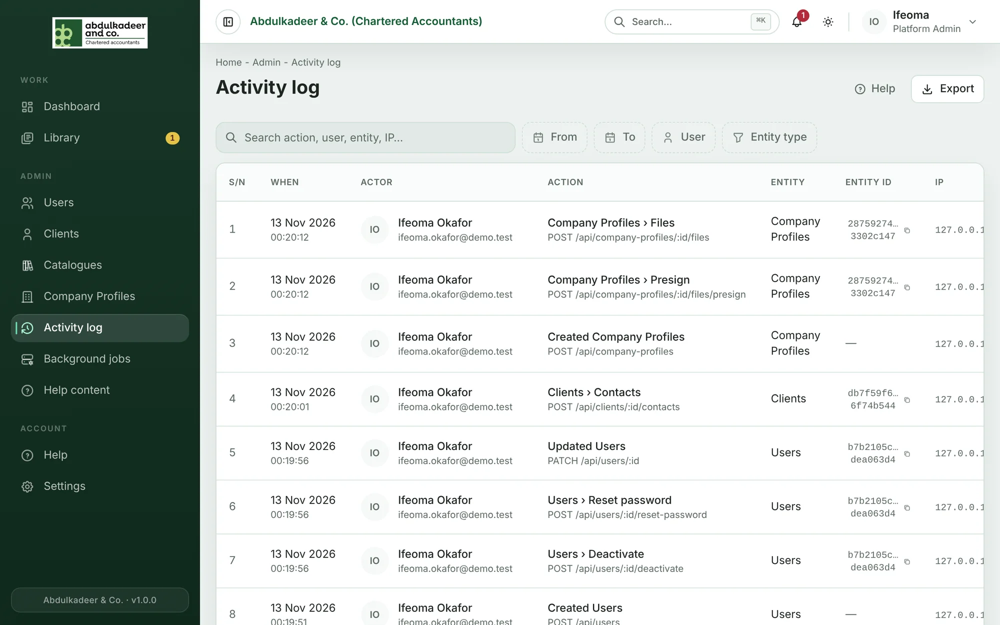
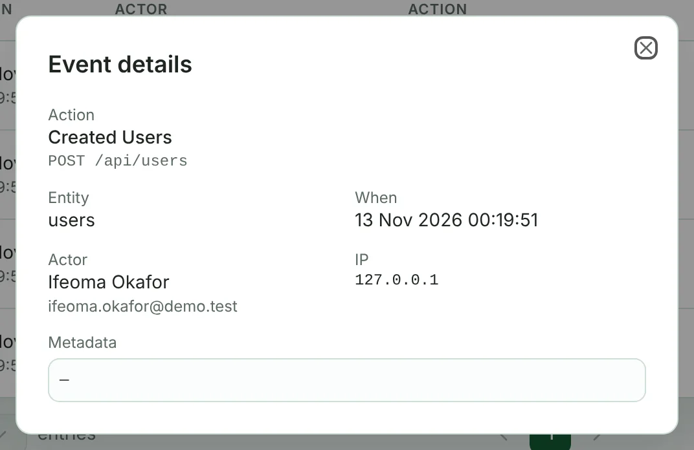

The **Activity log** is the portal's audit trail. **Platform Admins** and the **Principal Partner** can open it from **Activity log** in the sidebar.

## What is recorded

- **Sign-ins** — every successful sign-in, with the person and their IP address.
- **Every change** — whenever someone signed in creates, updates or deletes something (an engagement, request, file decision, user, catalogue entry, help article and so on), the change is recorded with who made it, when, the kind of record it touched and the address of the action.
- **Re-drives** from [Background jobs](help:background-jobs).

Looking at pages and reading documents are not recorded. Password and sign-in requests themselves are never logged, so no credentials end up in the log.

Actions are shown in plain words — *Signed in*, *Created Users*, *Updated Engagements*, or *Users › Reset password* for something done to one record. Each row shows **When**, the **Actor**, the **Action**, the **Entity** (the kind of record) and its **Entity ID**, and the IP address. Choose **Details** in a row's menu to see the full event, including any extra details stored with it. Click an entity ID to copy it.

## Find something

- **Search** looks across the action, the person, the entity and the IP address.
- **From** and **To** limit the log to a date range.
- **User** shows one person's activity.
- **Entity type** shows changes to one kind of record — for example only *users* or only *engagements*.

Filters combine. Clear them to go back to the full log.

## Export

Click **Export** to download the log as a CSV file. The export uses the filters you have set, so filter first to export, say, one user's activity for last month.

> [!NOTE]
> The activity log can't be edited or deleted from the portal — not even by a Platform Admin.
