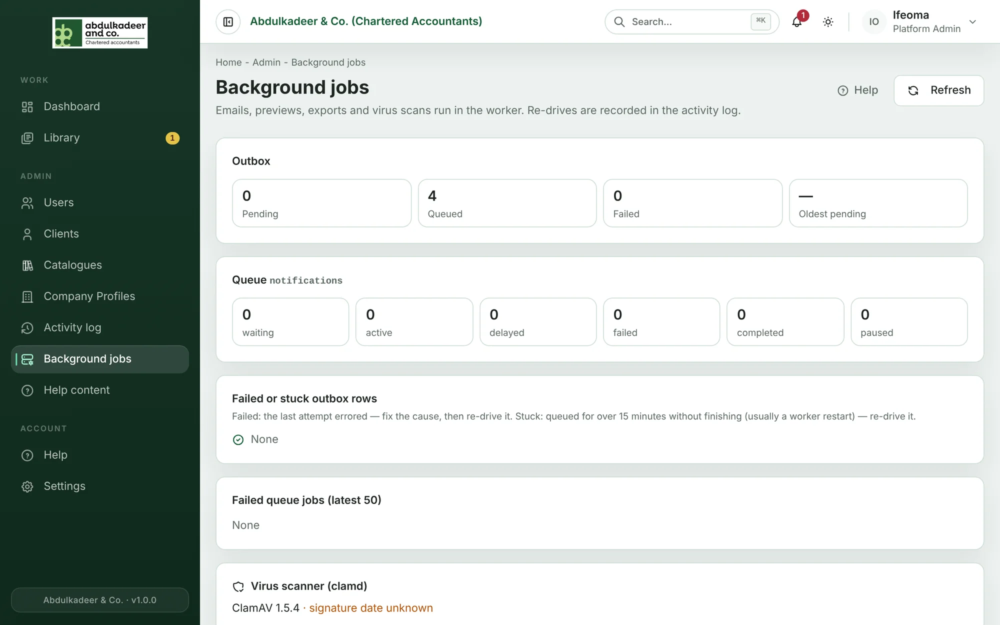

Some work happens in the background rather than while you wait: sending emails, making previews of Word and Excel files, building ZIP exports, and virus-scanning Library uploads. A separate service, the **worker**, does this. **Background jobs** (Platform Admins only) shows whether that work is keeping up.

## How the work flows

When something happens that needs background work — say, a request is created and the client must be emailed — the portal first writes an entry to its **outbox**, in the same step as the change itself, so the job can't be lost. Every 10 seconds new outbox entries are handed to the **queue**, and the worker picks them up from there.

## Reading the page

**Outbox**

| Figure | What it means |
| --- | --- |
| **Pending** | Waiting to be handed to the queue. It should normally be 0 or close to it. |
| **Queued** | Handed to the queue and not finished yet. *(n stuck)* means some have been queued for more than 15 minutes. |
| **Failed** | The last attempt ended in an error. |
| **Oldest pending** | How long the oldest pending entry has been waiting. It turns amber after 10 minutes — the hand-over isn't running. |

**Queue** shows the queue's own counts — *waiting*, *active*, *delayed*, *failed*, *completed* and *paused*. If it says Redis isn't configured, nothing is being queued at all.

**Failed or stuck outbox rows** lists each problem entry with its kind (for example `notification.email`), the error, and when it was created and last tried.

**Failed queue jobs (latest 50)** lists jobs the worker gave up on, with the reason.

**Virus scanner (clamd)** shows the scanner's version and how old its virus definitions are. Definitions older than 72 hours are shown in amber.

Click **Refresh** to update the figures.

## Re-drive a failed or stuck entry

1. Fix the cause first if there is one — for example, an email server that was down.
2. Click **Re-drive** on the row.

The entry is queued again and runs within a few seconds. Every re-drive is recorded in the [activity log](help:activity-log).

> [!TIP]
> Stuck entries usually mean the worker restarted part-way through a job. Re-driving them is safe.

> [!NOTE]
> Library files can't be downloaded until their virus check has passed — readers see **Checking for viruses…** meanwhile. If the scanner is down, files wait; after three attempts without an answer the item shows **Virus check failed** and a curator is alerted. Replacing the file starts a new scan.
