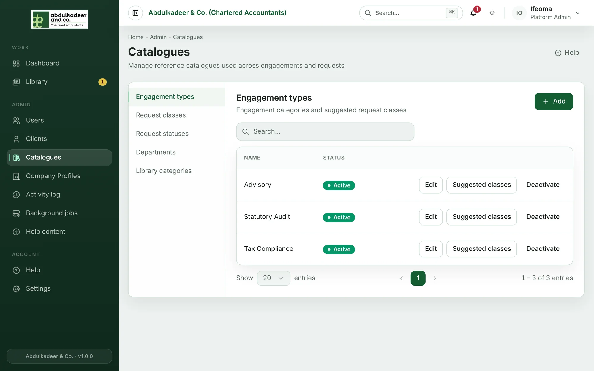
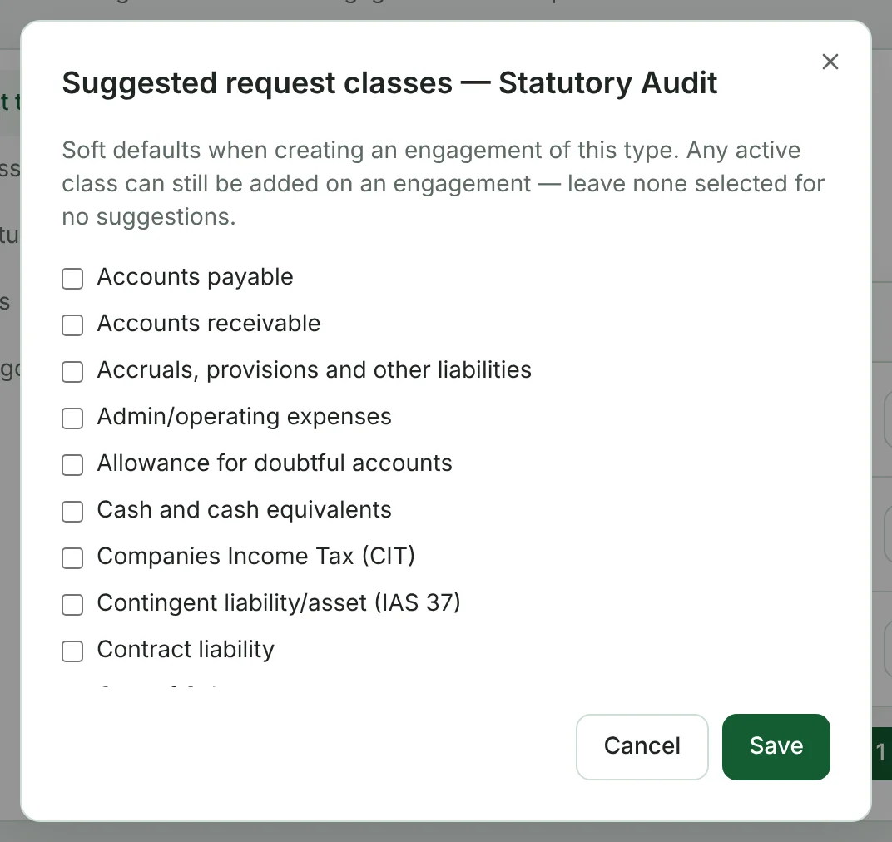
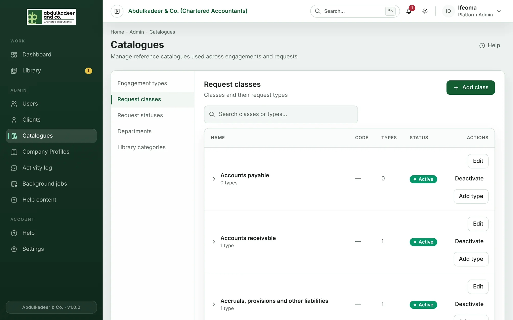
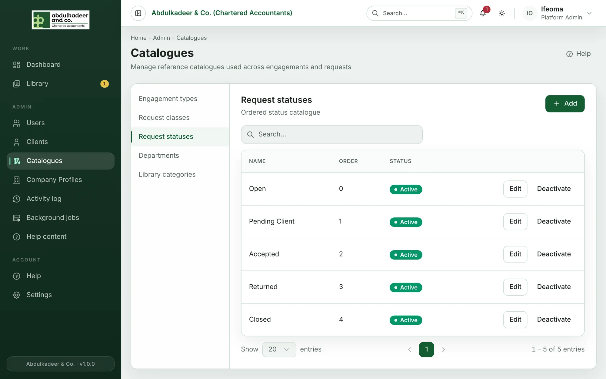
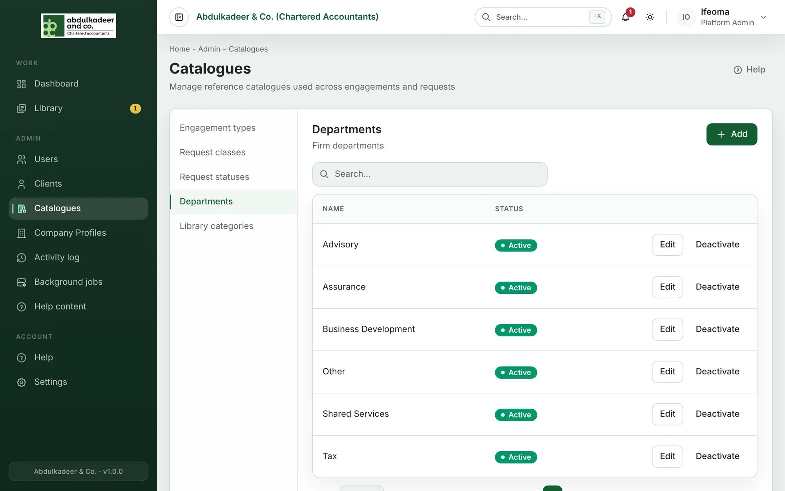

**Catalogues** holds the reference lists that the rest of the portal picks from — the options you see when you create an engagement or a request. **Platform Admins** maintain them; **Super Admins** can look but not change anything.

Open **Catalogues** in the sidebar and pick a list on the left. Every list works the same way:

- **Add** creates a new entry.
- **Edit** changes its name (and any other fields the list has).
- **Deactivate** retires it. Deactivated entries are no longer offered for new work, but everything that already uses them keeps them, so history stays intact. **Reactivate** brings one back.

Nothing in a catalogue is ever deleted, so it is always safe to tidy up by deactivating.

## Engagement types

The kinds of work the firm does — *Statutory Audit*, *Tax Compliance*, *Advisory* and so on. Super Admins choose one when they [create an engagement](help:creating-an-engagement), and can type a new one there if it's missing.

### Suggested request classes

Click **Suggested classes** on a type to tick the [request classes](help:request-classes) that usually belong to that kind of engagement, then click **Save**. When someone creates an engagement of that type, those classes are listed first. They are only suggestions — any active class can still be added to an engagement.

## Request classes and request types

Requests are grouped into **classes** (for example *Accounts receivable* or *Accruals, provisions and other liabilities*), and each class has **request types** — the specific things you ask a client for.

- **Add class** creates a class with a **Name** and optionally a **Code** and **Description**.
- Expand a class to see its types. **Add type** on a class creates a type in it, with an **Expected documents** number — how many files the client is normally expected to send. That number pre-fills **Expected documents** when someone [creates a request](help:creating-requests) of that type.
- Search finds classes and types by name.

> [!TIP]
> Staff and Super Admins don't have to wait for you: when the type they need is missing, they can create it while raising the request. Review new types here from time to time and tidy up near-duplicates by deactivating them.

## Request statuses

The statuses a Super Admin can give a request, in the order shown by **Order**.

> [!WARNING]
> Some status names have a meaning in the portal. Requests with status **Pending Client** are what a client sees under *Waiting on you* on their dashboard, and **Accepted** and **Closed** count as done when progress is worked out. Don't rename or deactivate these — add new statuses alongside them instead.

The *stage* of a request (Not Started, Submitted, In Progress, Reviewed) isn't a catalogue: the portal works it out from what has happened on the request. See [How requests work](help:how-requests-work).

## Departments

The firm's departments. Every user and engagement can belong to one, and the Library can restrict material to a department.

When you deactivate a department, the confirmation tells you if any Library items or collections are restricted to it. After deactivation only curators and the uploaders can see those, and they appear in the Library review queue under **Needs attention** so a curator can re-file them. See [Curating the Library](help:library-curating).

## Library categories

How items in the staff Library are grouped. Each category has a **Name**, an optional **Description** and a **Sort order** (lower numbers come first). Deactivating a category stops it being offered when uploading or filtering; items already in it keep it.
