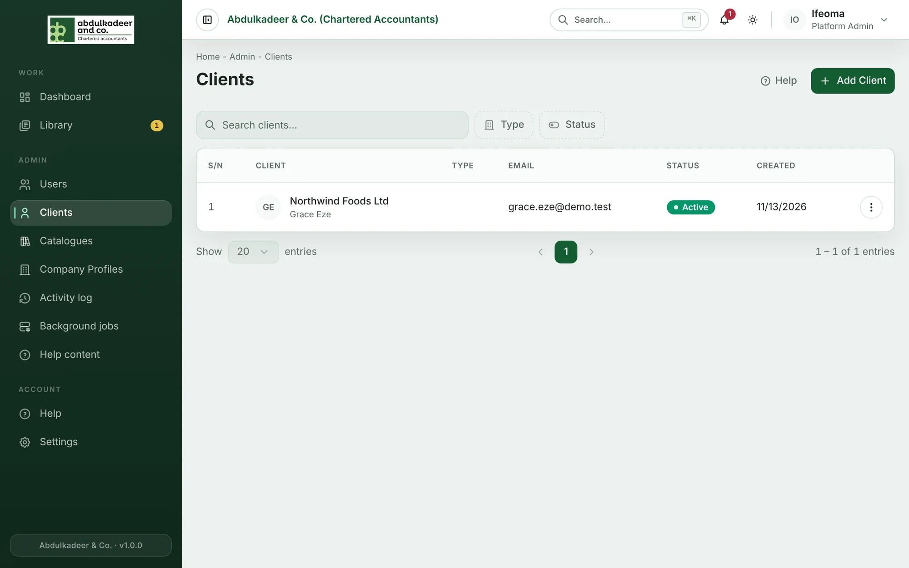
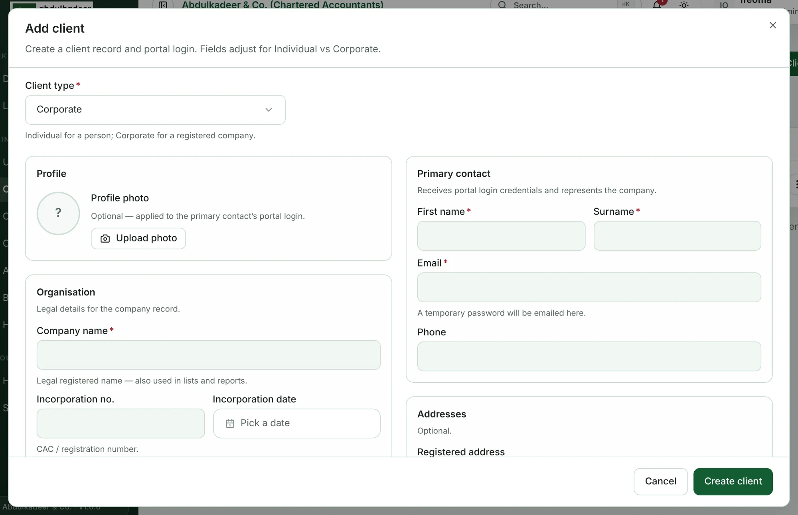
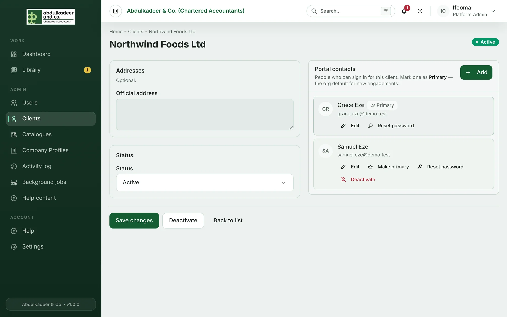
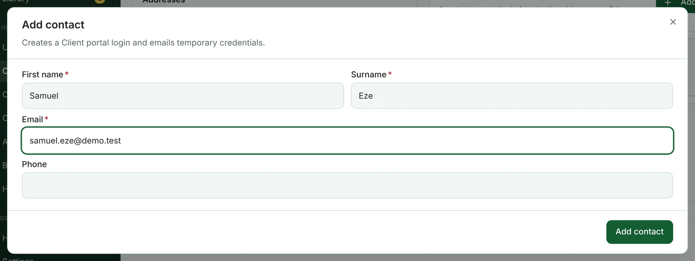

A **client** is the organisation (or person) you do the work for. Each client has one or more **portal contacts** — the people at the client who sign in to the portal to answer requests, upload files and review final reports. **Platform Admins** and **Super Admins** can manage clients.

## Add a client

1. Open **Clients** and click **Add Client**. (Super Admins can also add one while creating an engagement — **Create client** at the bottom of the client list.)
2. Choose the **Client type**:
   - **Individual** — a person. The individual *is* the portal login, so you enter their **First name**, **Surname** and **Email** and no separate contact is needed.
   - **Corporate** — a registered company. Enter the **Company name** (the legal name, used in lists and reports), optionally the **Incorporation no.** and **Incorporation date**, the company's general email and phone, and the **Primary contact** — the person who receives the first portal login.
3. Addresses and a profile photo are optional.
4. Click **Create client**.

The client's first portal login is created straight away, and a temporary password is emailed to the primary contact's address. Client names must be unique, and a contact's email can't belong to another user.

## Portal contacts

Open a client (row menu **⋮** → **View / Edit**) to see its **Portal contacts** panel. Everyone listed can sign in for that client.

### Add a contact

1. In **Portal contacts**, click **Add**.
2. Enter **First name**, **Surname** and **Email** (and a **Phone** if you have one).
3. Click **Add contact**.

The new contact receives their own login and temporary password by email. Adding a contact doesn't put them on any engagement — the engagement lead chooses which client contacts see each engagement (see [The engagement team and client contacts](help:engagement-team-and-contacts)).

### The primary contact

One contact is marked **Primary**. When a Super Admin creates a new engagement for this client, the primary contact is selected for them automatically. To change it, click **Make primary** on another contact and confirm with **Set primary**.

### Edit, reset or deactivate a contact

- **Edit** — change the name, email or phone, then **Save contact**. Changing the email changes their login.
- **Reset password** — emails them a new temporary password, which they must change when they next sign in.
- **Deactivate** — the contact can no longer sign in. Two rules protect live work:
  - You can't deactivate the **primary** contact — make someone else primary first.
  - You can't deactivate someone who is still a contact on an engagement — remove them from those engagements first.

Deactivated contacts move to an **Inactive** list at the bottom of the panel.

## Edit or deactivate a client

On the client's page, change the details and click **Save changes**. To retire a client, click **Deactivate** and confirm — the client is marked inactive and drops out of the default lists.

Deactivating a client also switches off the portal for **all of its contacts**: they can't sign in or reset their password, and anyone signed in is signed out within about 15 minutes. If they try to sign in, they're told their organisation's portal access is switched off.

To bring the client back, set **Status** to *Active* and save. Its contacts can sign in again straight away with their existing passwords — contacts you had deactivated individually stay deactivated.
