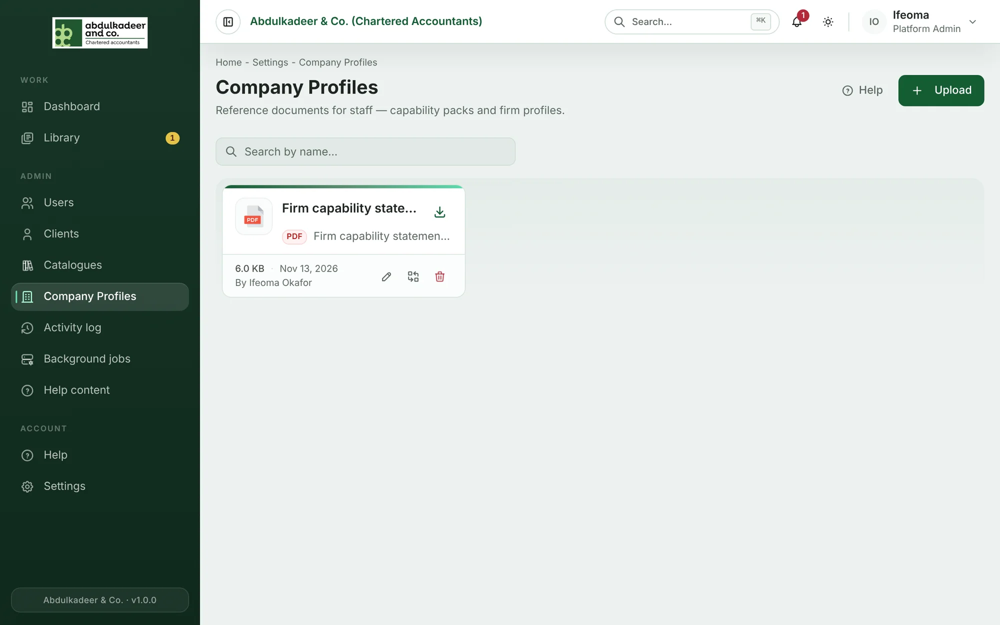
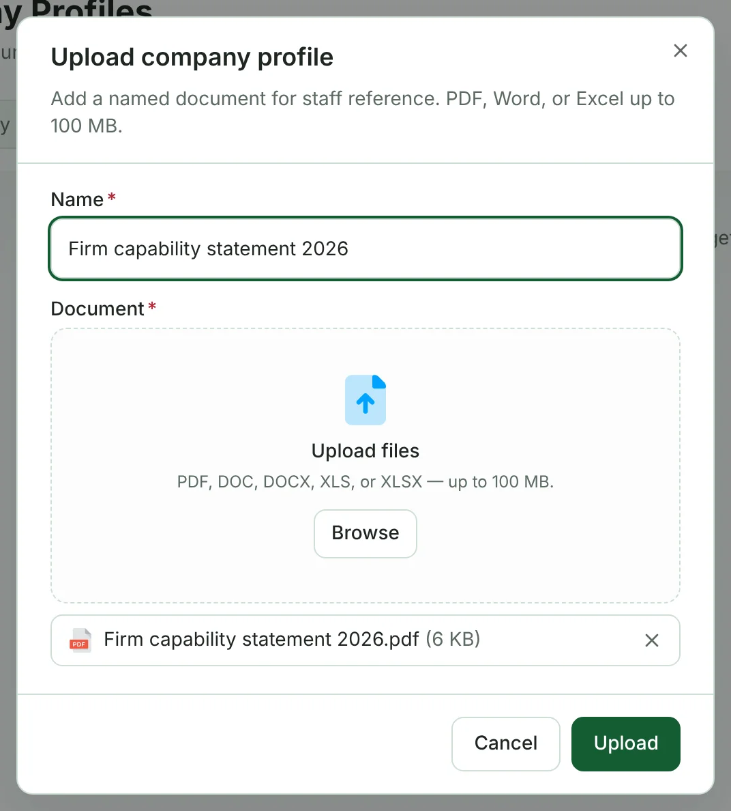

**Company Profiles** holds the firm's own reference documents — capability statements, firm profiles and similar packs that staff send to prospects or quote from in proposals. Everyone on the firm side can read and download them; only a **Platform Admin** can add or change them.

## Read or download a profile

- Click a card to read the document in the viewer. **Download** in the viewer, or the download icon on the card, saves a copy.
- **Search by name…** filters the cards.

Each card shows the file type and size, when it was uploaded and who uploaded it.

## Upload a profile

1. Click **Upload**.
2. Give it a **Name** — what staff will search for, for example *ACA capability statement 2026*.
3. Under **Document**, drop the file or click **Browse**. PDF, Word (DOC, DOCX) and Excel (XLS, XLSX) files up to 100 MB are accepted.
4. Click **Upload**.

## Keep profiles up to date

The icons on a card (for Platform Admins) let you:

- **Rename** — change the name staff see.
- **Replace file** — upload this year's version in place, so the name and the card stay the same.
- **Remove** — take the profile away. It no longer appears for anyone.

> [!TIP]
> Replace a profile rather than uploading a second one next to it — staff then always find the current version under the familiar name.
