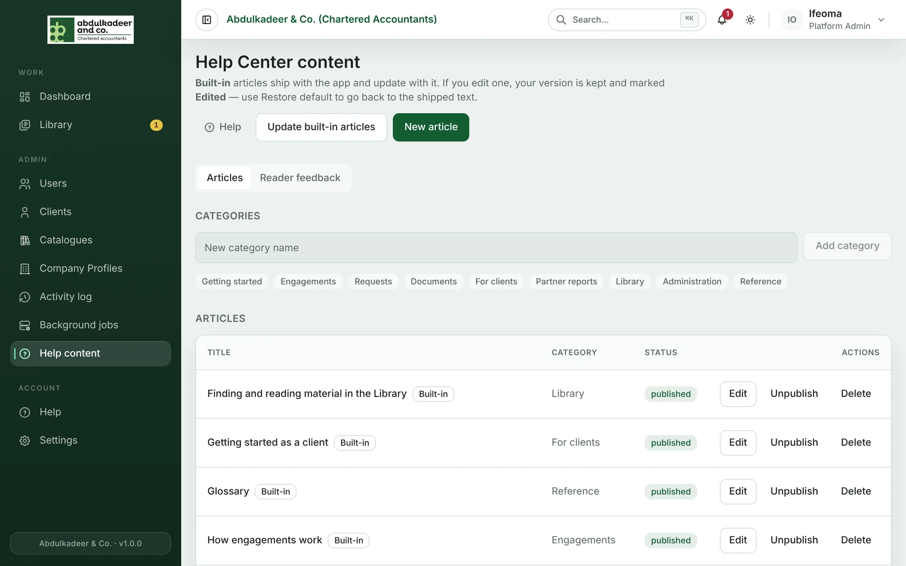
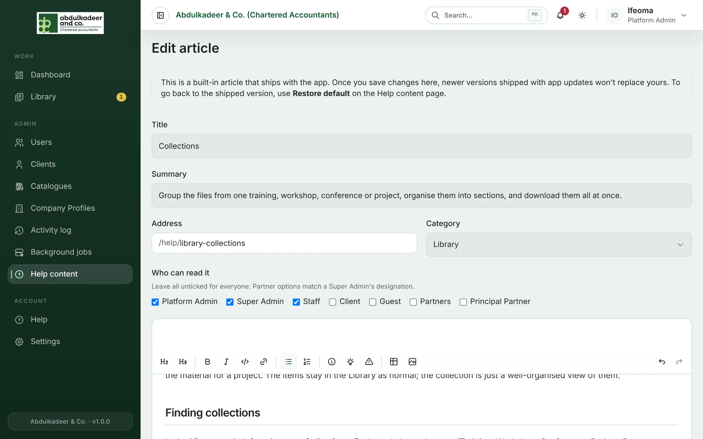
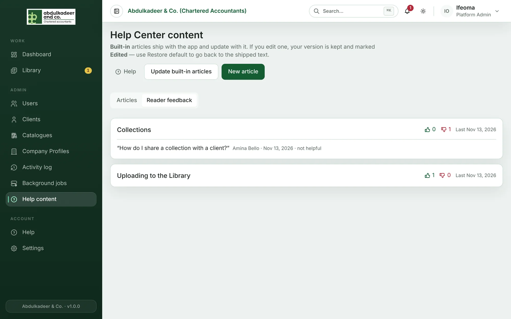

These help pages are managed from **Help content** in the sidebar, by **Platform Admins** and **Super Admins**.

## Built-in and your own articles

- **Built-in** articles ship with the portal and are updated with it. When the portal is upgraded, new and improved built-in articles are installed automatically.
- **Your own** articles are ones written here. Upgrades never touch them.

If you edit a built-in article, your version is kept from then on and marked **Edited** — later upgrades won't overwrite it. **Restore default** on that row (confirm with **Restore default**) throws your changes away and goes back to the shipped text, which then keeps updating again.

**Update built-in articles** installs the shipped articles straight away instead of waiting for the next restart, and tells you how many were added, updated and kept because you had edited them.

## Write or edit an article

1. Click **New article**, or **Edit** on an article's row.
2. Fill in:
   - **Title** — what people search for.
   - **Summary** — one sentence shown under the title, on the category cards and in search results.
   - **Address** — the end of the article's link, `/help/<address>`, in lower case with dashes.
   - **Category** — where it appears in the Help Center.
   - **Who can read it** — tick the roles that should see it. Leave everything unticked for everyone. **Partners** and **Principal Partner** match a Super Admin's partner designation, for articles about partner reports.
3. Write the body. The toolbar has headings and sub-headings, bold, italic, `code / button name`, links, bulleted lists, numbered steps, **Note**, **Tip** and **Important** boxes, tables and images (PNG, JPEG or WebP up to 5 MB).
4. Click **Save**.

A new article starts as a **draft** that only help editors can see. Click **Publish** on its row when it's ready, and **Unpublish** to take any article back out of the Help Center.

> [!TIP]
> Use headings for the main sections — they become the **On this page** list beside the article — and numbered steps for anything people do in order. Name buttons exactly as they appear on screen, in bold.

### Categories

Type a name under **Categories** and click **Add category** to create a new one, then choose it as the **Category** of your articles.

### Hiding or deleting

To hide a built-in article, **Unpublish** it — it stays unpublished through upgrades. **Delete** removes an article permanently; a deleted built-in article is installed again at the next upgrade, so unpublish built-in articles instead.

## The Help buttons on each page

Most pages have a **Help** button next to their title that opens the matching article. They point at the built-in addresses, so if you rewrite an article keep its address the same.

## Reader feedback

At the end of every article readers are asked **Was this article helpful?** If they answer no, they can add a short note about what was missing. The **Reader feedback** tab collects the answers: thumbs up and down per article, when the last answer came in, and every comment with who left it.

Articles with several "not helpful" answers and comments are the ones to improve first.
