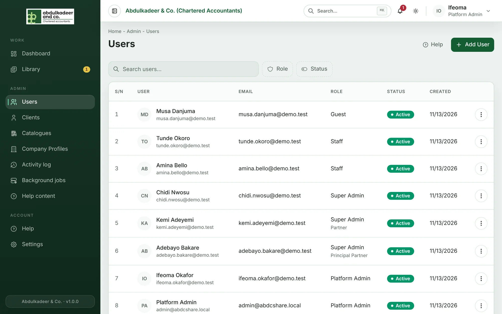
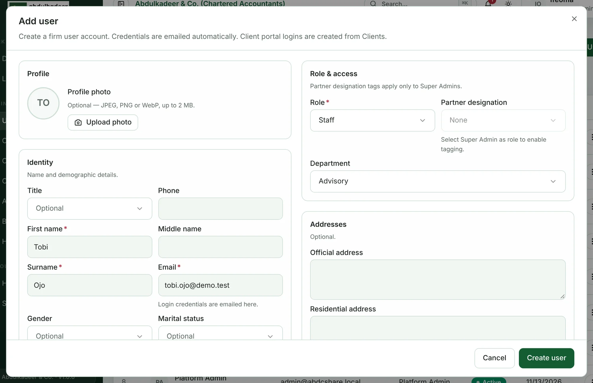
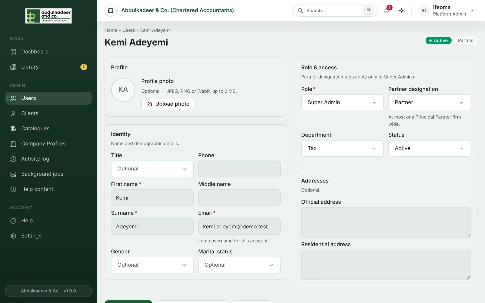
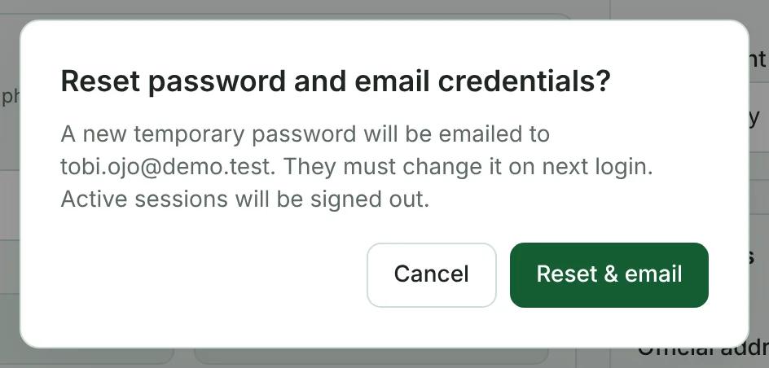

The **Users** page lists everyone who can sign in to the firm side of the portal. Only a **Platform Admin** can add or change users. **Super Admins** can open the page and look people up, but every field is read-only for them.

> [!NOTE]
> Client logins are not created here. A client's portal login is created with the client, and further logins are added as **portal contacts** — see [Clients and their portal contacts](help:clients-and-contacts). Guest accounts are created when the Principal Partner invites a guest to submit a partner report.

## Roles at a glance

| Role | Who it is for | What it can do |
| --- | --- | --- |
| **Platform Admin** | The people who run the portal | Users, catalogues, departments, company profiles, the activity log, background jobs and help content. Platform Admins don't work on engagements. |
| **Super Admin** | Partners and managers | Create and run engagements, set request status, decide reviews, sign off, send final reports to clients, manage clients. |
| **Staff** | Practitioners | Work inside the engagements they are on: raise requests, review client files, upload working papers, submit work for review. |

A Super Admin can also carry a **partner designation** — **Partner** or **Principal Partner** — which switches on [partner reports](help:partner-reports-overview). The full matrix is on [Who can do what](help:who-can-do-what).

## Add a user

1. Open **Users** and click **Add User**.
2. Fill in **First name**, **Surname** and **Email**. The email is the person's login, and their temporary password is sent to it.
3. Under **Role & access**, choose a **Role**: *Platform Admin*, *Super Admin* or *Staff*.
4. For a Super Admin, choose a **Partner designation** if they are a partner. It is greyed out for other roles.
5. Choose their **Department**. Library material restricted to a department is shown to that department's people, so set this for everyone who has one.
6. The rest — title, phone, middle name, gender, marital status, profile photo and addresses — is optional.
7. Click **Create user**.

The new user receives an email with their email address, a temporary password and a link to sign in. The first time they sign in, the portal makes them choose their own password (see [Signing in](help:signing-in)).

> [!WARNING]
> There can be only **one Principal Partner** in the firm. To hand the role over, set the current Principal Partner's designation to *Partner* or *None* first, then give it to the new person.

## Change someone's details

1. On **Users**, open the row's menu (**⋮**) and choose **View / Edit**. You can search by name or email, and filter by **Role** and **Status**.
2. Change what you need — name, **Email**, **Role**, **Partner designation**, **Department**, **Status** or the profile photo.
3. Click **Save changes**.

Things to know:

- **Changing the email changes the login.** Tell the person to sign in with the new address.
- **Changing the role or designation** reaches the person within about 15 minutes, or straight away if they sign out and back in. If you move someone away from Super Admin, their partner designation is removed too.
- The portal won't let you demote or deactivate the **last active Platform Admin** — there must always be one.

## Reset a password

If someone is locked out or their temporary password email went astray:

1. Open the user (or use the row menu on **Users**) and click **Reset & email password**.
2. Confirm with **Reset & email**.

   

A new temporary password is emailed to them, they must change it on their next sign-in, and any sessions they have open are signed out. You can't reset the password of an inactive user — reactivate them first.

> [!TIP]
> People can reset their own password from the sign-in page with **Forgot password?** — you only need to step in when that email can't reach them.

## Deactivate or reactivate a user

When someone leaves the firm, deactivate them rather than deleting anything — their work, uploads and history stay attributed to them.

1. Open the user and click **Deactivate** (or choose **Deactivate** in the row menu).
2. Confirm. They can no longer sign in, and any session they have open ends within about 15 minutes.

To bring someone back, open them, set **Status** to *Active* and click **Save changes**. Use **Status → Inactive** in the filter on **Users** to find deactivated accounts.

> [!NOTE]
> Deactivating a user doesn't take them off engagement teams. If they led or worked on live engagements, ask the engagement lead to update the team — see [The engagement team and client contacts](help:engagement-team-and-contacts).
