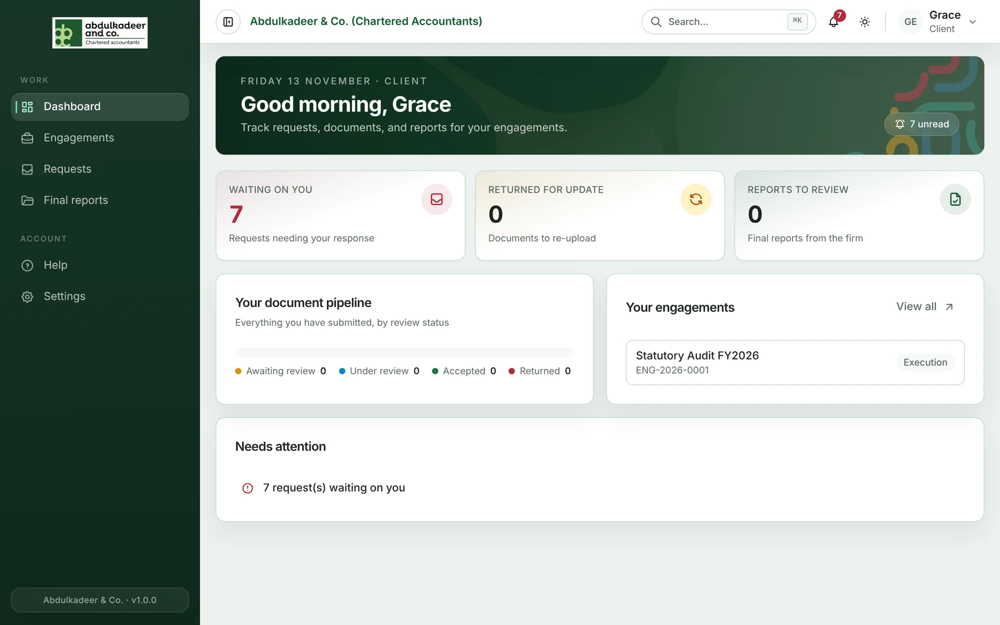
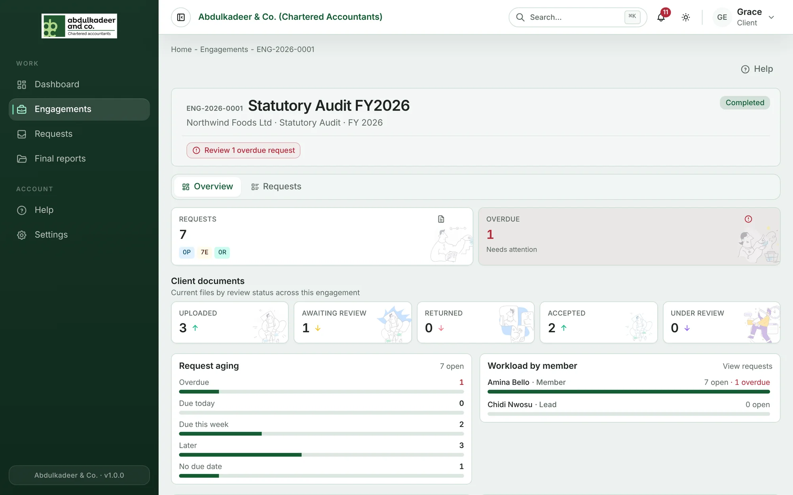

As a client contact you use the portal to send the firm the documents they ask for, talk to the team about them, and review and approve the final report — all in one place, instead of email.

Your account is created by the firm. You'll get an email with a temporary password; the first time you sign in you choose your own. See [Signing in](help:signing-in).

## Your dashboard

- **Waiting on you** — requests the firm is waiting for you to answer. Start here.
- **Returned for update** — files the team sent back to you with a note.
- **Reports to review** — final reports waiting for your approval.
- **Your document pipeline** — what you've sent and where it stands.
- **Your engagements** — the pieces of work the firm is doing for you.

## The menu

- **Engagements** — each piece of work, for example *Statutory Audit FY2026*. You see the engagements you've been added to as a contact.
- **Requests** — everything the firm has asked for, across your engagements.
- **Final reports** — reports shared with you for review.

## Notifications

You'll get a notification — and an email, if you're set up to receive them — when the firm asks for something, returns a file, posts in a discussion, or sends you a report. Choose what you're told about in **Settings → Notifications**.
