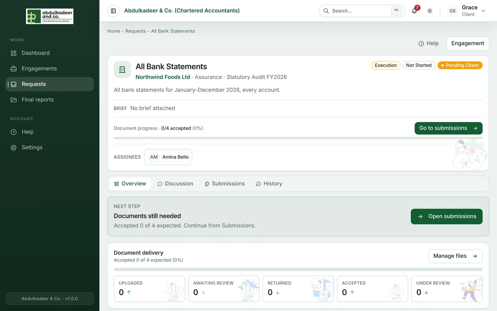
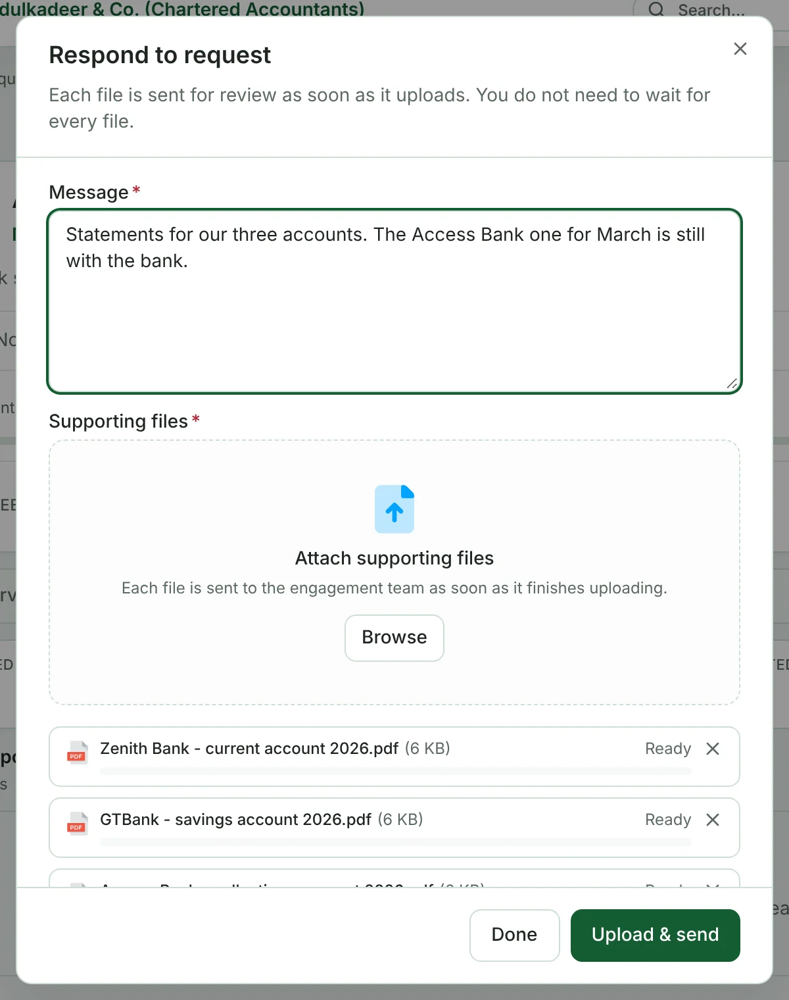
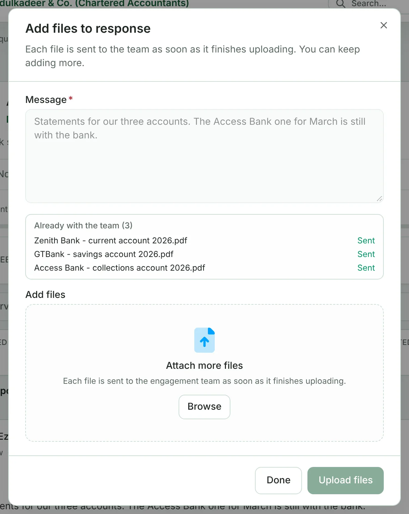
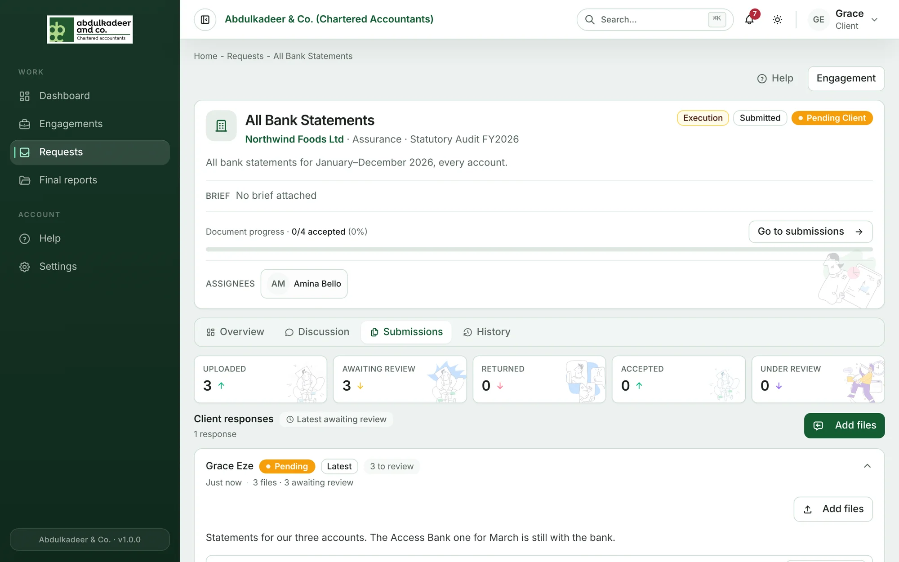

1. Open the request — from **Waiting on you** on your dashboard, from **Requests**, or from the link in the notification.
2. Read what's needed: the description, the due date and, if there is one, the **Brief** (an example or template from the firm). **Document progress** shows how many files the firm expects and how many they've accepted.

   

3. Go to **Submissions** (or click **Go to submissions**) and click **Send response**.
4. Write a short **Message** — for example, anything that's missing and why.
5. Drag your files in, or click **Browse**. You can add several at once.
6. Click **Upload & send**.

Each file goes to the team as soon as it finishes uploading — you don't have to wait for all of them. Each finished file shows **Sent**.

## Adding more files later

Open the request again and use **Add files** on your response. They're sent the same way.

## If your upload is interrupted

Files that finished are already with the team. Open the request, click **Continue response** or **Retry failed uploads**, and re-attach only what didn't finish. If you go offline, uploads resume when your connection returns.

## What happens next

The team reviews each file and accepts it or returns it with a note. You can follow this on the request's **Submissions** tab, where each file shows its status — **Pending**, **Under review**, **Accepted** or **Returned**.

