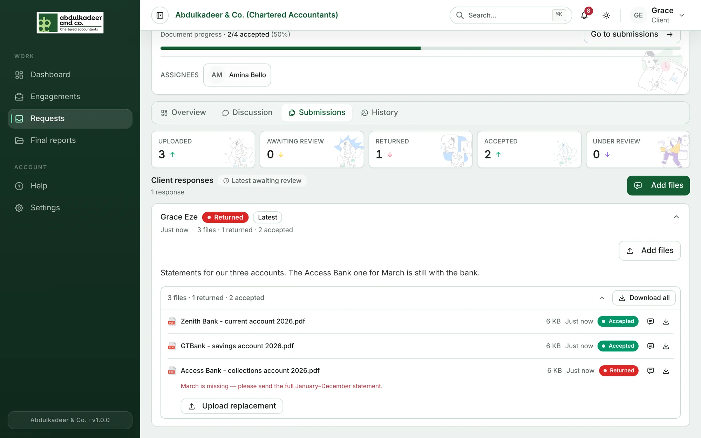
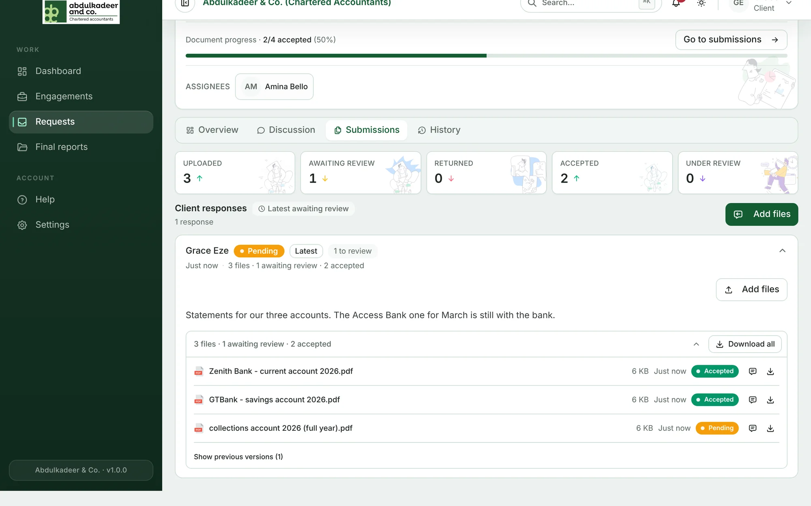

If something's wrong with a file — a page missing, the wrong period — the team **returns** it with a note. You're notified, and the file shows under **Returned for update** on your dashboard.

1. Open the request and go to **Submissions**.
2. Find the file marked **Returned** and read the note under it.

   

3. Click **Upload replacement** and choose the corrected file.

The replacement goes to the team for review, and the returned file is kept as a previous version.

> [!TIP]
> Not sure what's wanted? Ask on the request's **Discussion** tab. See [Talking to the team](help:talking-to-the-team).
