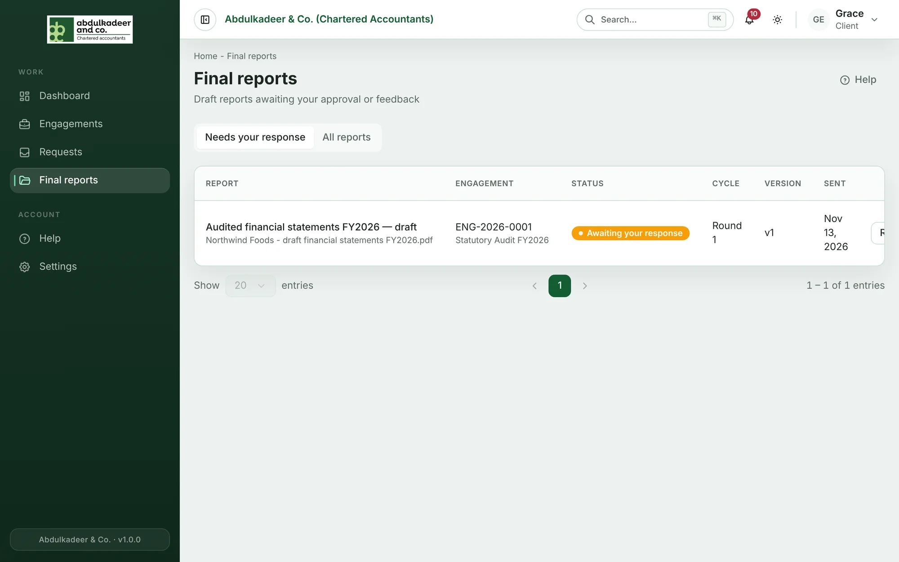
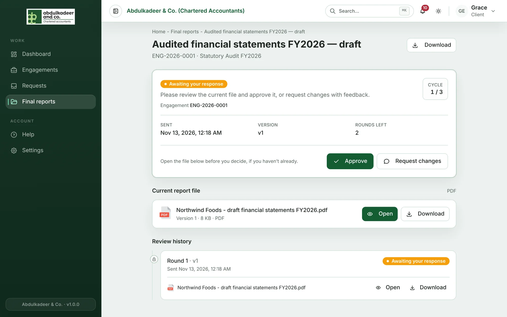
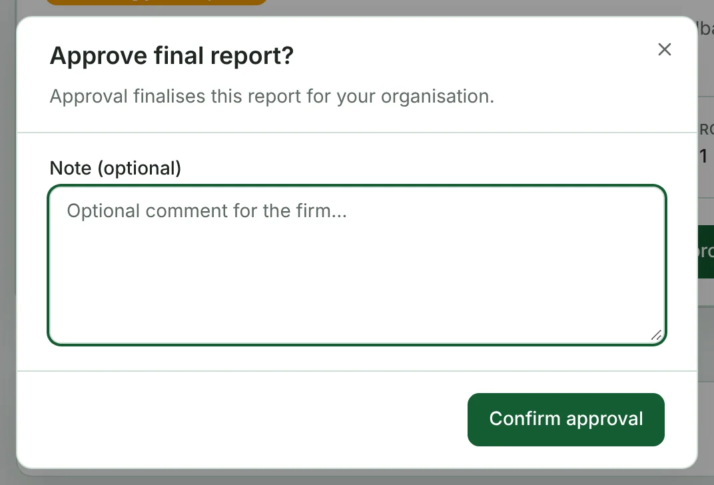
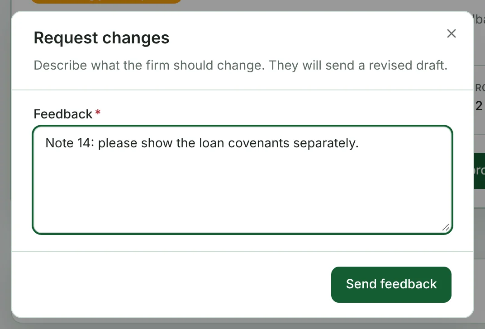
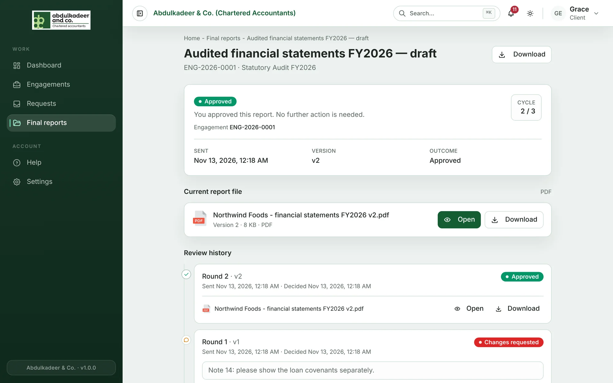

When the firm sends you a draft of the final report you're notified, and it appears under **Reports to review** on your dashboard and in **Final reports**.

## Reviewing it

1. Open **Final reports** and click the report. **Needs your response** lists those waiting for you; **All reports** lists everything shared with you.
2. Read the **Current report file** in the browser, or download it.

   

3. Then either:

   - **Approve** — click **Approve**, then **Confirm approval**. Approval finalises the report for your organisation.

     

   - **Request changes** — describe what the firm should change and click **Send feedback**. The firm sends a revised draft, which appears here when ready.

     

There can be up to three rounds of review. The page shows the round you're on, how many are left, and the history of earlier rounds.

