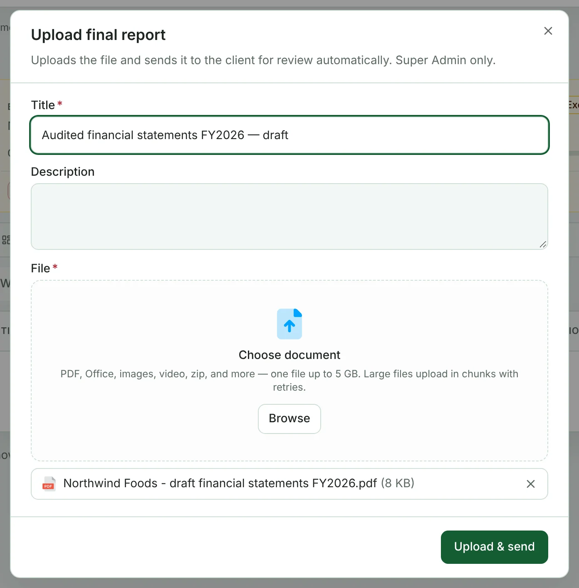
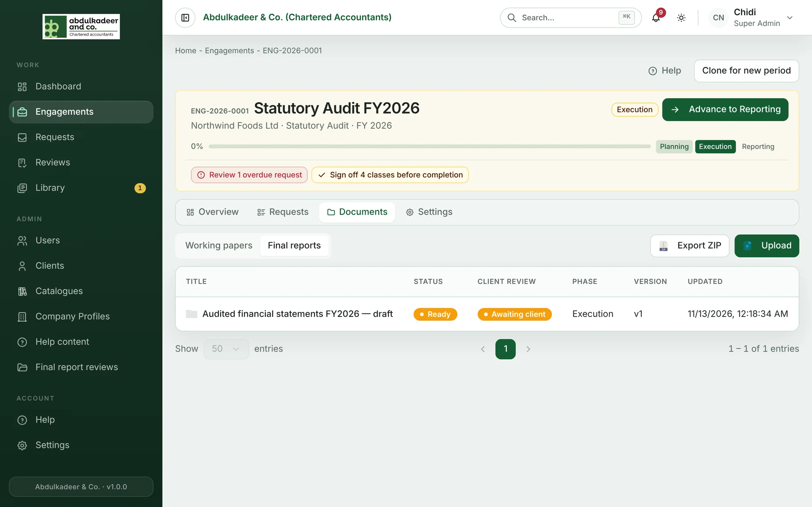
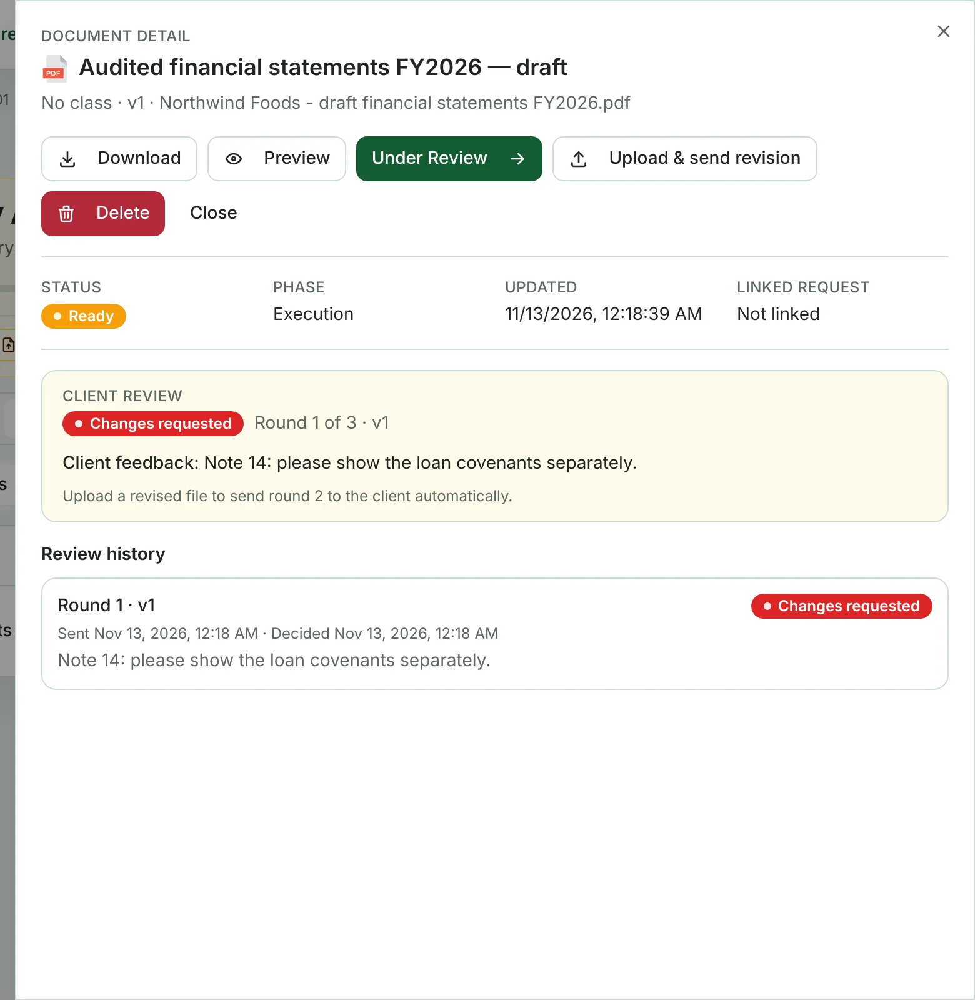
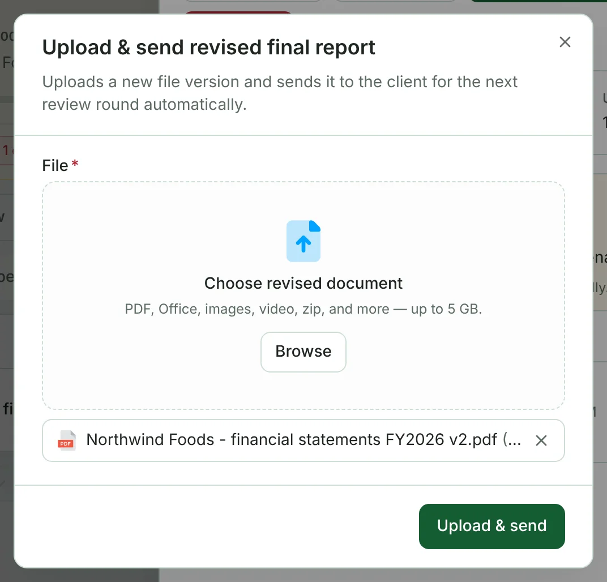

The **final report** is the engagement's deliverable. Super Admins upload it and send it to the client, who either approves it or asks for changes. A report can go through **up to three rounds**.

## Sending the first draft

1. Open the engagement, go to **Documents** and select **Final reports**.
2. Click **Upload**, enter a **Title** (for example *Audited financial statements FY2026 — draft*), choose the file, and click **Upload & send**.

The client's contacts are notified (**Final report for review**) and the report shows **Round 1 of 3**. If the upload works but sending fails, open the report and use **Send to client**.

## When the client asks for changes

Open the report. The **Client review** box shows **Changes requested**, the round, and the client's feedback; **Review history** lists every round.

1. Click **Upload & send revision**.
2. Choose the revised file and click **Upload & send**.

The new version goes to the client automatically as the next round.

## When the client approves

The report is finalised and issued — it shows **Approved**, the team is notified (**Final report finalised**), and nothing more is needed. This is usually the last step before signing off and completing the engagement. See [Stages and sign-off](help:engagement-stages-and-sign-off).

## After three rounds — Locked

If the client hasn't approved after three rounds, the report is **Locked**. A Super Admin decides how to proceed: open the report and click **Override lock**, give the **Reason**, and confirm. This finalises and issues the report without the client's approval, and the report shows **Overridden**. Use it deliberately — the reason is recorded.

## Final report reviews (all engagements)

**Admin → Final report reviews** lists final reports across every engagement, in three views: **Needs firm action** (changes requested, or locked), **Awaiting client** and **All sent**. Search by title, engagement or feedback, or filter by engagement and review state.
