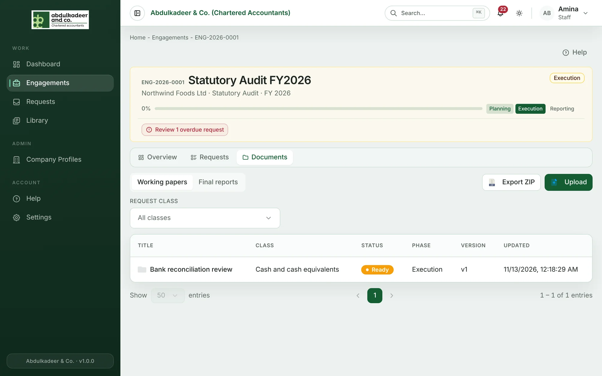
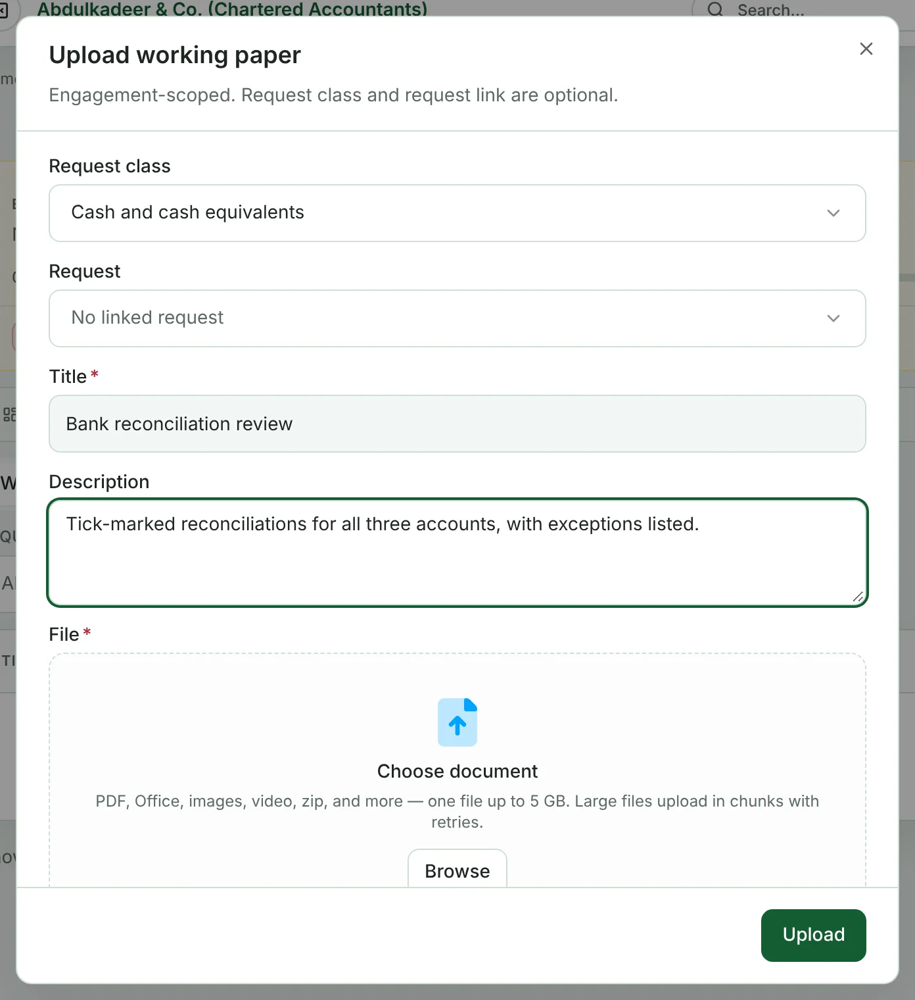

**Working papers** are the firm's own files for an engagement — schedules, analyses, lead sheets. They live on the engagement's **Documents** tab and are never shown to the client.

## Uploading a working paper

Super Admins and staff on the engagement can upload.

1. Open the engagement, go to **Documents** and make sure **Working papers** is selected.
2. Click **Upload**.
3. Optionally choose a **Request class**, and a **Request** in that class to link it to. Linked working papers also show on the request's **Linked working papers** tab.
4. Enter a **Title** and, if useful, a **Description**.
5. Choose the file and click **Upload**.

Use the **Request class** filter above the list to see one class at a time.

## Opening a working paper

Click a working paper to open its details: class, version, file, status, phase, when it was updated and the linked request. From there you can **Download** or **Preview** it.

## Review status

A working paper moves through these statuses with the button in its details (for example **Under Review →**):

| Status | Meaning |
| --- | --- |
| **Ready** | Uploaded and ready to look at. |
| **Under Review** | Being reviewed. |
| **Signed Off** | Signed off — only a Super Admin can make this final step. |

The engagement team is notified each time a document's status changes (**Document status changed**).

## Deleting

Super Admins can delete a document, with all its file versions. This can't be undone.
