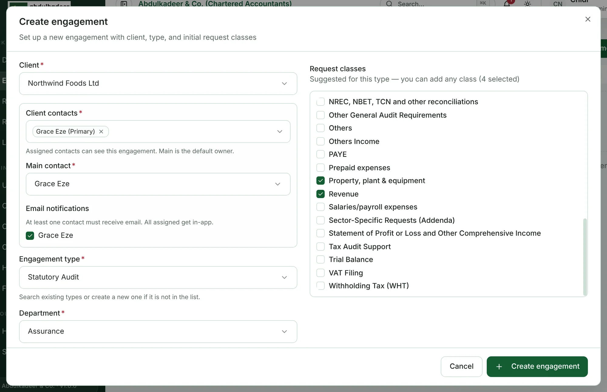
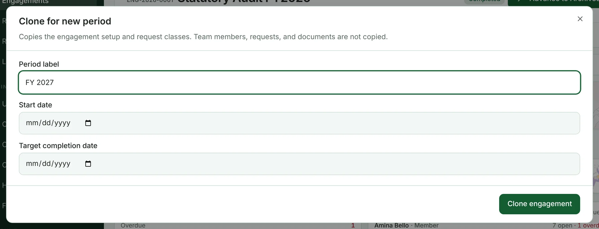

Only **Super Admins** create engagements. The person who creates an engagement becomes its **Lead**.

## Create an engagement

1. Open **Engagements** and click **Create engagement**.
2. **Client** — search for the client. (If you can manage clients, **Create client** at the bottom of the list adds a new one.)
3. **Client contacts** — the client's primary contact is selected for you. Add anyone else at the client who should see the engagement.
4. **Main contact** — the default owner on the client side.
5. **Email notifications** — tick who should receive emails. At least one contact must; everyone assigned gets in-app notifications.
6. **Engagement type** — for example *Statutory Audit*. If the type isn't in the list, type its name and create it.
7. **Department** — the team that owns the work.
8. **Title** (for example *Statutory Audit FY2026*) and **Period label** (*FY 2026*). Optionally a **Start date** and **Target completion** date.
9. **Request classes** — tick the classes in scope. Classes suggested for the engagement type are listed first; you can add any class, now or later.
10. Click **Create engagement**.

The engagement opens in the **Planning** stage, with a reference such as **ENG-2026-0001**.

> [!TIP]
> Next, add the rest of the team on the **Settings** tab and upload the engagement letter as a planning document. See [Team and client contacts](help:engagement-team-and-contacts) and [Planning documents](help:planning-documents).

## Clone an engagement for a new period

For recurring work, start from last year's engagement:

1. Open the engagement and click **Clone for new period** (top right).
2. Enter the new **Period label** (for example *FY27*) and, optionally, the **Start date** and **Target completion date**.
3. Click **Clone engagement**. The new engagement opens in **Planning**.

Cloning copies the engagement setup and its request classes. **Team members, requests and documents are not copied** — add the team again on the Settings tab.

