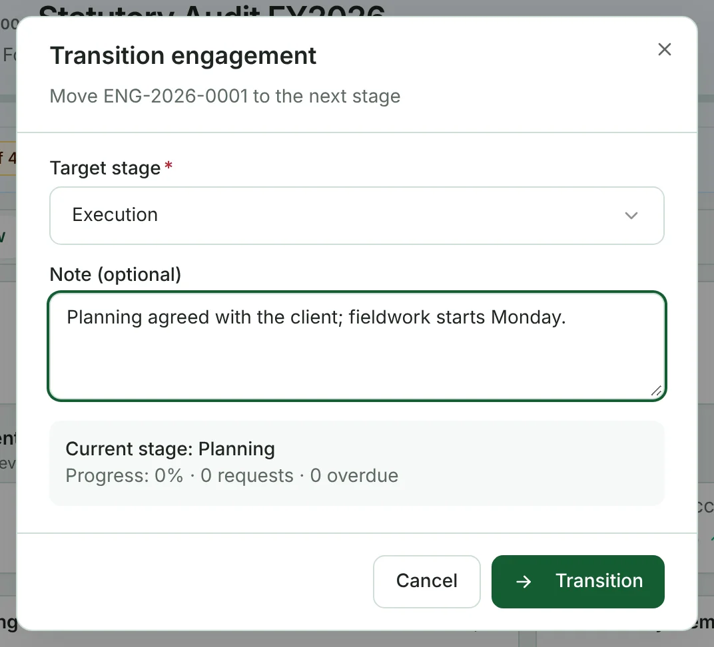
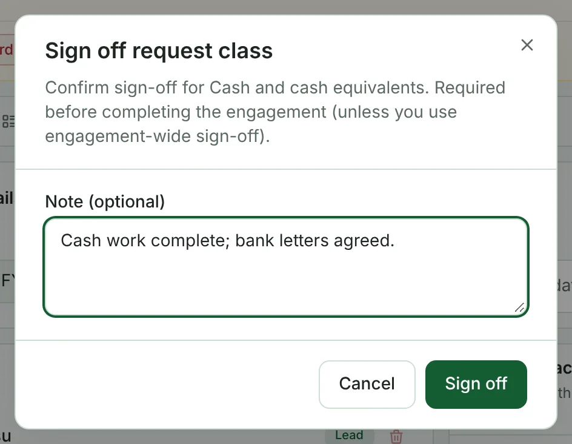
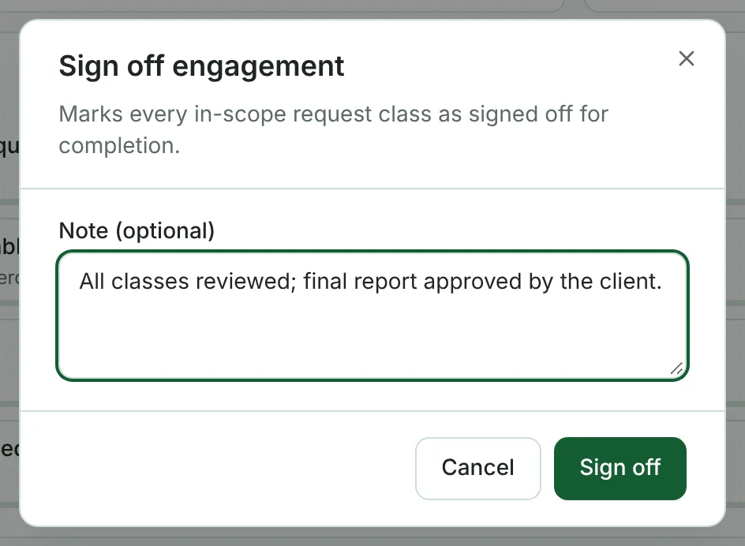
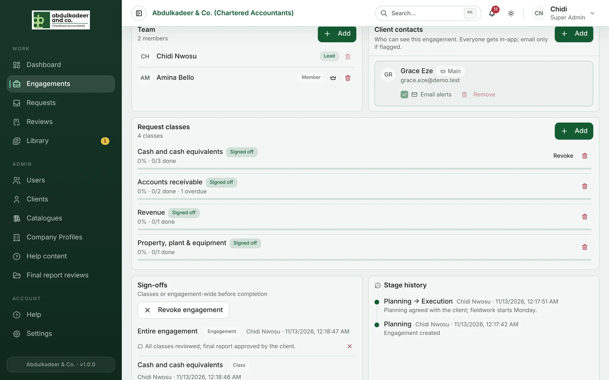
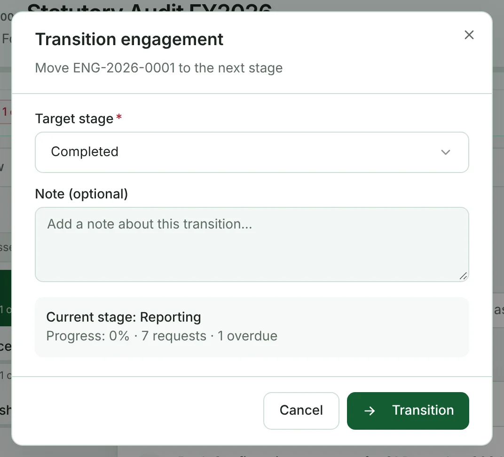
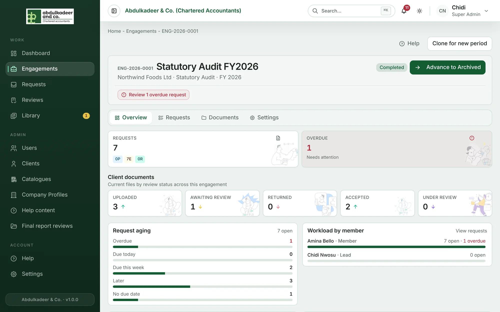

Every engagement moves through five stages:

| Stage | What it means |
| --- | --- |
| **Planning** | Set-up: team, scope, engagement letter and other planning documents. |
| **Execution** | Fieldwork: requests to the client, review of what they send, working papers. |
| **Reporting** | Final report drafts and the client's review. |
| **Completed** | The work is done and signed off. |
| **Archived** | Closed for good. |

Requests and documents are stamped with the phase the engagement was in when they were created (Planning, Execution or Reporting), so you can always see when something came in.

## Moving to the next stage

Only the **Super Admin who created the engagement** can move it between stages.

1. Click **Advance to …** at the top right of the engagement (for example **Advance to Execution**).
2. Check the **Target stage**, add an optional **Note** for the team, and click **Transition**.

Engagements can also step back one stage — from Execution to Planning, Reporting to Execution, or Completed to Reporting — by choosing that stage as the target. Archived is final.

The team is notified whenever the stage changes, and the change is recorded in the engagement's history.

## Sign-off before completion

An engagement can only be **Completed** once it is signed off — either every request class in scope, or the engagement as a whole. Until then the header shows *Sign off N classes before completion*.

Super Admins and the engagement's Lead can sign off, on the **Settings** tab:

- **A class** — click **Sign off** next to the class in **Request classes**.

  

- **The whole engagement** — under **Sign-offs**, click **Sign off engagement**. This marks every in-scope class as signed off.

  

Each sign-off is listed under **Sign-offs** with who signed and when. If something changes, **Revoke** removes your sign-off. Sign-off doesn't lock anything — the team can still work on the engagement.

Then move the engagement to **Completed** with **Advance to Completed**.

