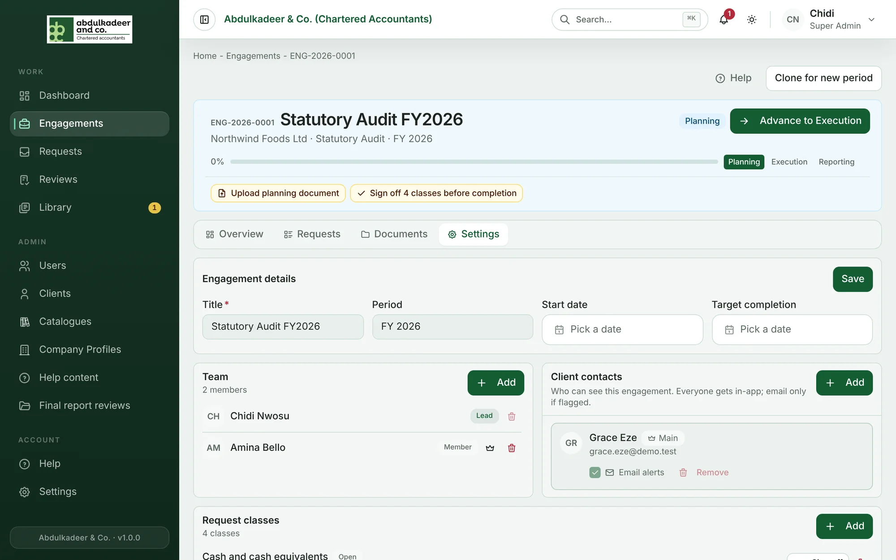
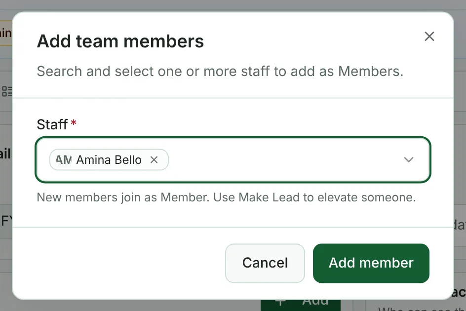

Both are managed on the engagement's **Settings** tab, by a Super Admin or the engagement's Lead.

## The team

Staff only see the engagements they are on, so add everyone who will work on it.

1. Under **Team**, click **Add**.
2. Search for and select one or more people, then add them.

   

New people join as **Member**. Each engagement has a **Lead** — at first, the person who created it.

- **Make Lead** (the crown icon) makes a member the Lead; the current Lead becomes a Member.
- **Remove** (the bin) takes someone off the team. You can't remove the only Lead — make someone else Lead first.

The Lead can manage the engagement's details, team, contacts and request classes and sign it off, even if they are Staff.

## Client contacts

Client contacts are the people at the client who can see the engagement in the portal.

- **Add** — choose contacts from the client's organisation.
- **Main** — the default owner on the client side. **Make main** on another contact moves it to them.
- **Email alerts** — tick to send that contact emails as well as in-app notifications. At least one contact must receive email.
- **Remove** — they lose access to this engagement. The main contact (and the last remaining contact) can't be removed.

> [!NOTE]
> New client contacts are added to the client's organisation by an administrator (**Admin → Clients**) before they can be added to an engagement.
