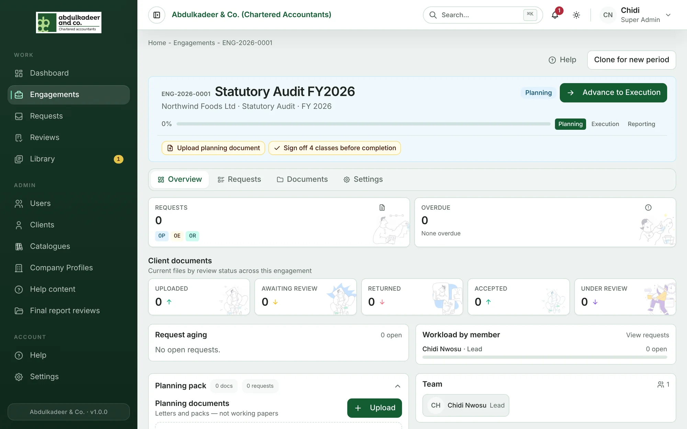
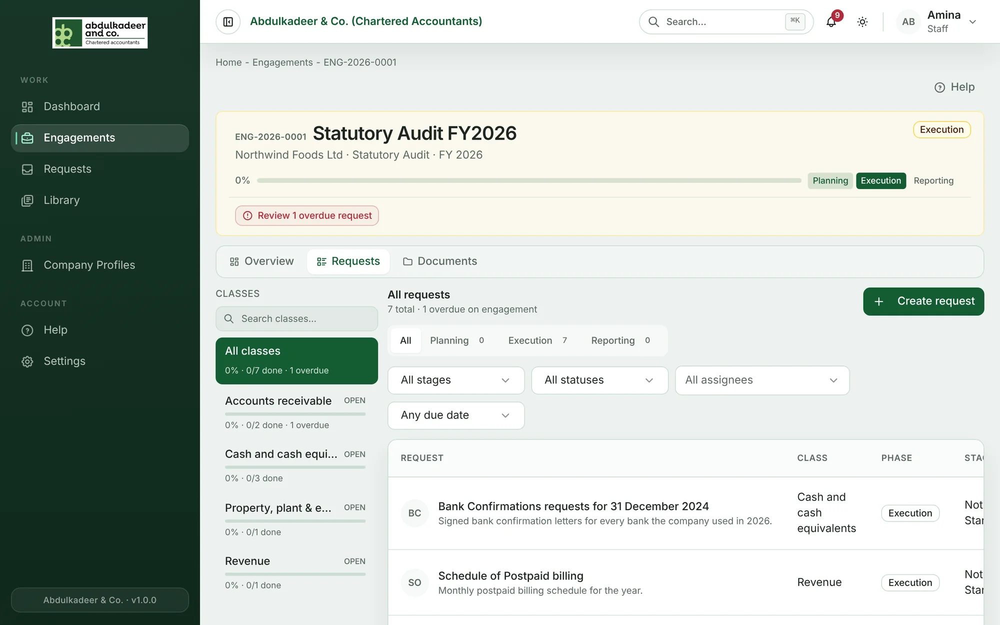
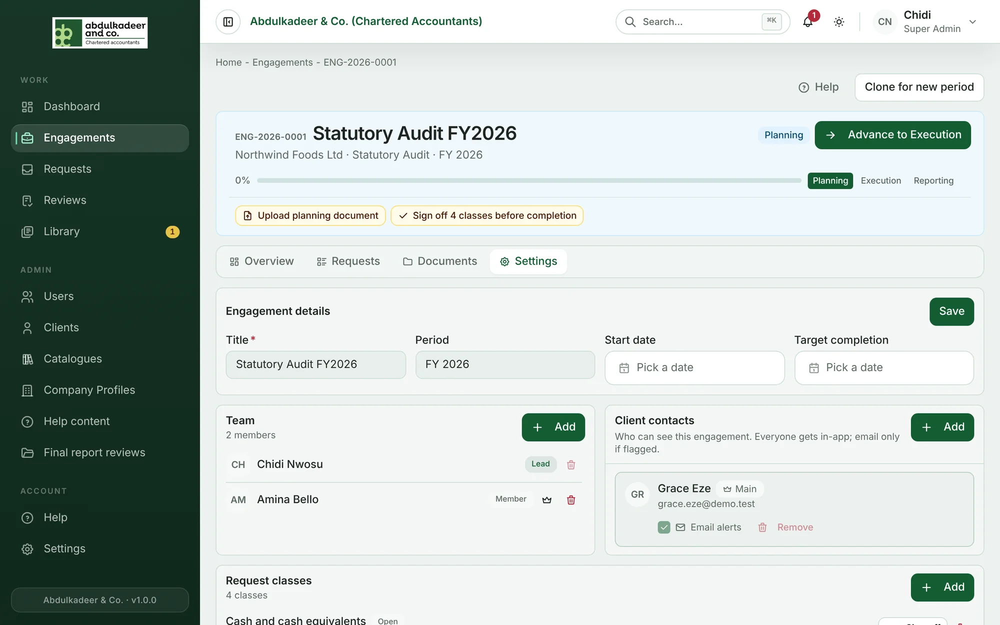

Each engagement has up to four tabs. You see the ones your role can use.

## Overview

The engagement at a glance:

- **Requests** and **Overdue** counts, with requests split by phase (Planning, Execution, Reporting).
- **Client documents** — files the client has sent, by review status: **Uploaded**, **Awaiting review**, **Returned**, **Accepted**, **Under review**.
- **Request aging** — open requests that are overdue, due today, due this week, later, or have no due date.
- **Workload by member** — open and overdue requests per team member.
- **Team** and **Request classes**.
- **Planning pack** — planning documents and the requests raised during Planning. See [Planning documents](help:planning-documents).

## Requests

Every request in the engagement. The **Classes** list on the left filters by request class and shows each class's progress; the tabs above the list split requests by phase; and the filters narrow by stage, status, assignee and due date. **Create request** adds a new one. See [Creating requests](help:creating-requests).

## Documents

Staff and Super Admins only. **Working papers** and **Final reports**, with **Upload** and **Export ZIP**. See [Working papers](help:working-papers) and [Final reports and the client review](help:final-reports-client-review).

## Settings

For Super Admins and the engagement's Lead: **Engagement details** (title, period, dates), **Team**, **Client contacts**, **Request classes** and **Sign-offs**.

