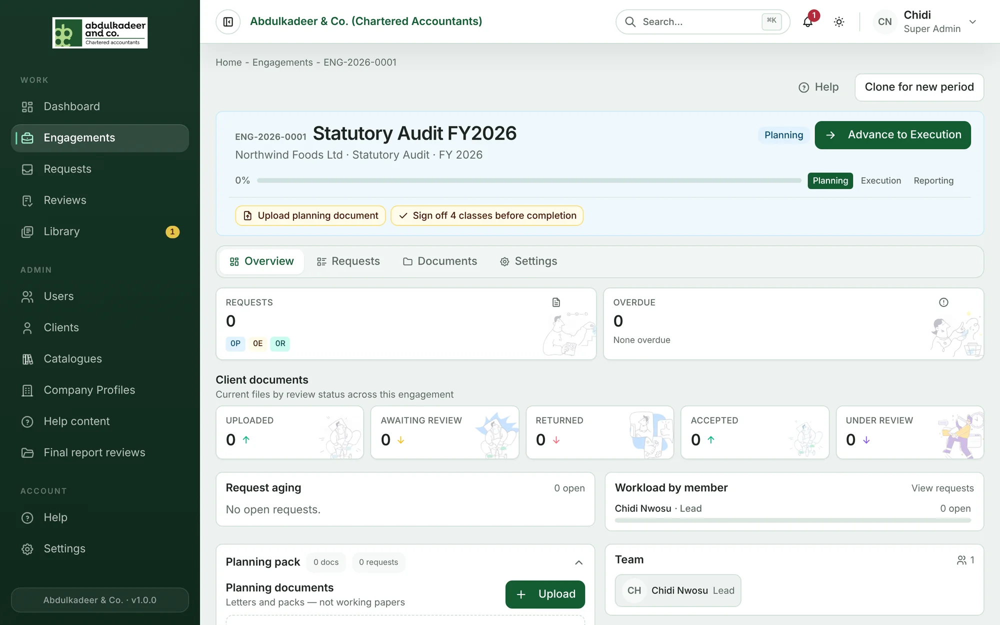
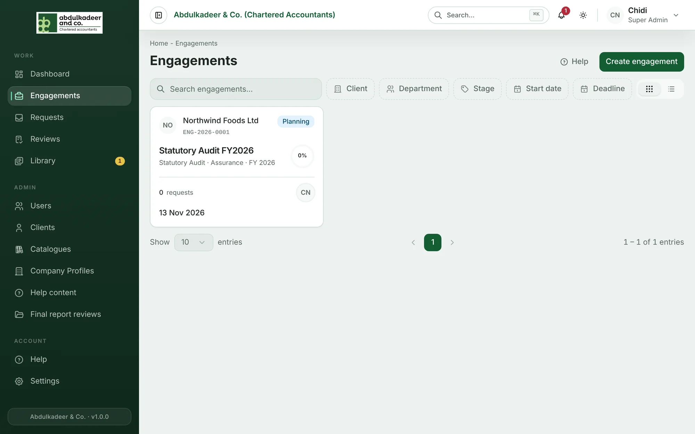

An **engagement** is a discrete piece of work for one client — for example *Statutory Audit FY2026* for Northwind Foods. Everything about that work hangs off it:

- the **team** from the firm, with one **Lead**;
- the **client contacts** who can see it;
- the **request classes** in scope — the groups requests are organised into (for an audit, financial-statement lines such as *Cash and cash equivalents*);
- the **requests** for documents, and what the client has sent;
- **planning documents**, **working papers** and **final reports**;
- its **stage**: Planning → Execution → Reporting → Completed → Archived.

## Finding engagements

Open **Engagements** in the menu. You see the engagements you can access:

- **Staff** see the engagements they are on the team of.
- **Clients** see their own organisation's engagements that they are a contact on.
- **Super Admins** see every engagement.

Each engagement has a reference such as **ENG-2026-0001**, shown in its header and breadcrumbs. You can also find one quickly with **Ctrl + K**.

## The header

The top of every engagement shows its reference, title, client, type and period; the **stage** badge; an overall **progress** bar (the share of requests that are accepted or closed); and the stage track (Planning, Execution, Reporting).

Underneath, **next actions** point at what needs doing — for example *Upload planning document*, *Review 1 overdue request* or *Sign off 4 classes before completion*. Click one to jump to the right place.

## Who does what

| | Super Admin | Engagement Lead | Staff on the team | Client contact |
| --- | --- | --- | --- | --- |
| Create or clone an engagement | ✓ | | | |
| Edit details, team, contacts, classes | ✓ | ✓ | | |
| Move to the next stage | the Super Admin who created it | | | |
| Sign off classes or the engagement | ✓ | ✓ | | |
| Raise requests, review client files | ✓ | ✓ | ✓ | |
| Answer requests | | | | ✓ |

See [Who can do what](/help/who-can-do-what) for the full table.
