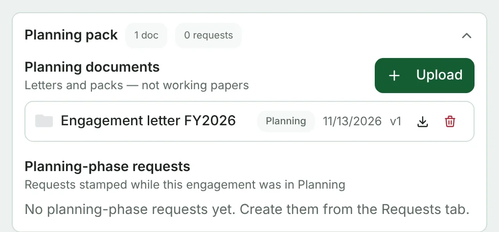
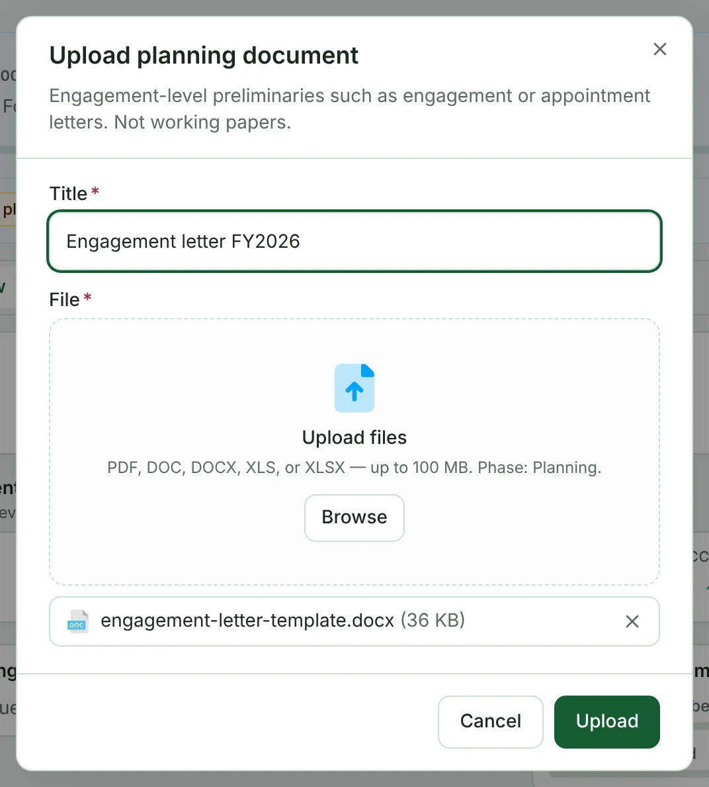

**Planning documents** are engagement-level preliminaries such as the engagement letter or appointment letter. They are not working papers.

They live in the **Planning pack** on the engagement's **Overview** tab, together with the requests raised while the engagement was in Planning. Once the engagement leaves Planning the pack is collapsed — click its heading to open it.

## Uploading a planning document

Super Admins, the engagement's Lead and client contacts can upload planning documents.

1. On the **Overview** tab, in **Planning documents**, click **Upload**.
2. Give it a **Title** (for example *Engagement letter FY2026*) and choose the file — PDF, DOC, DOCX, XLS or XLSX, up to 100 MB.
3. Click **Upload**.

Each document shows its phase, date and version. Use the download button to get a copy; Super Admins (and whoever uploaded it) can delete it with the bin.
