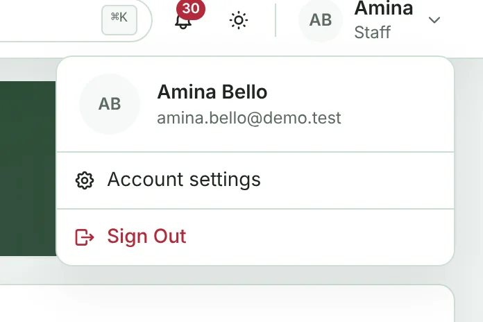
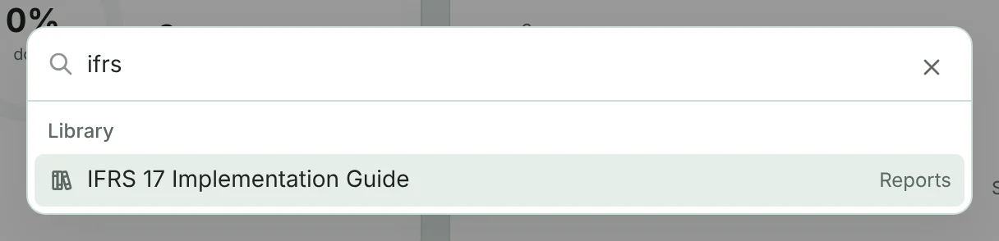
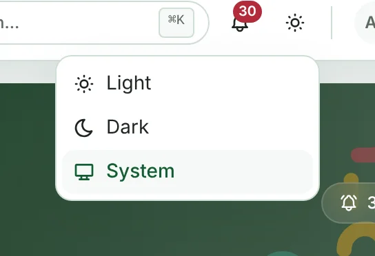
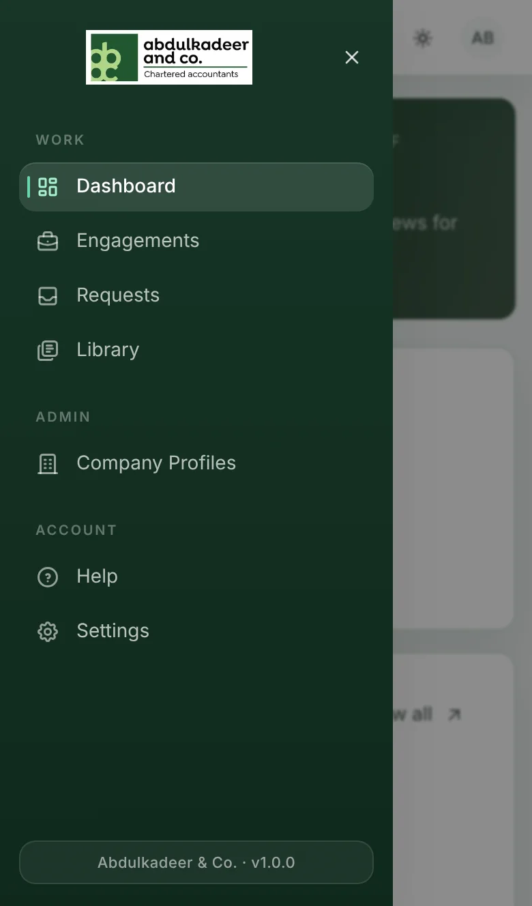
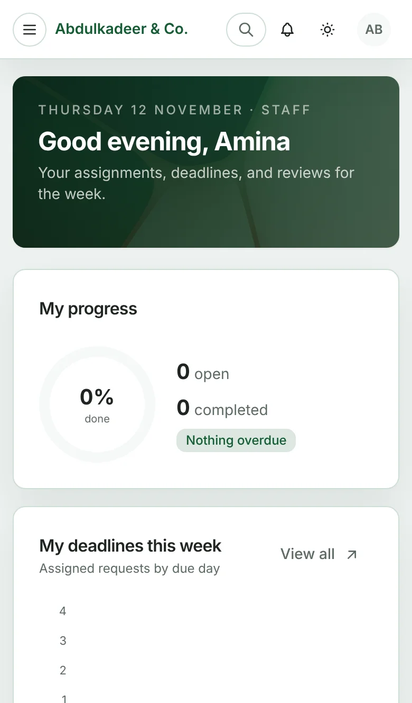
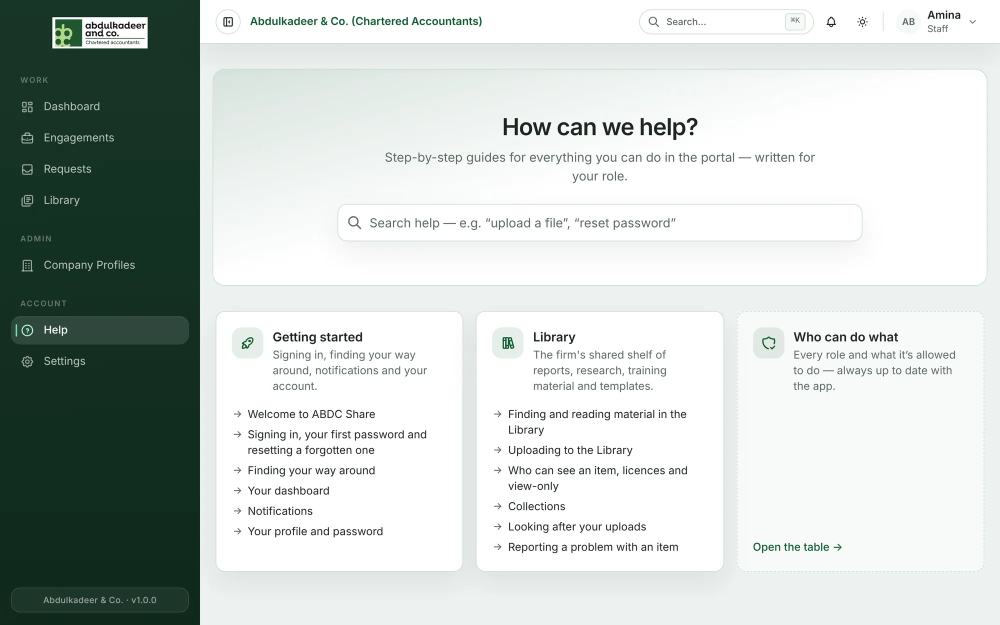

## The menu

The menu on the left is grouped into **Work** (your day-to-day pages), **Admin** (if your role has any administration) and **Account** (**Help** and **Settings**). You only see the items your role can use.

Click the button at the very top left, next to the firm's name, to collapse the menu to icons and give pages more room. Click it again to expand it.

## The top bar

From left to right on the right-hand side:

- **Search…** — search the whole portal (see below).
- The **bell** — your notifications. A red number shows how many are unread. See [Notifications](help:notifications).
- The **sun / moon** — light or dark mode.
- **Your name** — your account settings and **Sign Out**.

## Searching everything

Press **Ctrl + K** (**⌘ K** on a Mac), or click **Search…**, and start typing. Results are grouped into **Engagements**, **Requests**, **Documents**, **Library** and **Clients** — only things you're allowed to see. Use the arrow keys and **Enter**, or click a result, to open it.

## Light, dark or system

Click the sun / moon icon and choose **Light**, **Dark** or **System** (follow your computer's setting). The choice is remembered on that device.

## Lists, filters and links

Most pages are lists you can search, filter and sort. Filters are kept in the page address, so you can bookmark a filtered list or send the link to a colleague — they'll see the same view (limited to what they're allowed to see).

## On a phone

The portal works in your phone's browser. The menu is hidden behind the **☰** button at the top left; tap it to open the menu, and tap a page to go there.

## Help on every page

Look for **Help** (with a question mark) at the top of a page. It opens the guide for that page in a side panel, so you can read it without losing your place. **Open full article** takes you to the full guide in the Help Center.

The Help Center itself is **Help** in the menu: search it, or browse the guides by topic. You only see the guides for your role.

