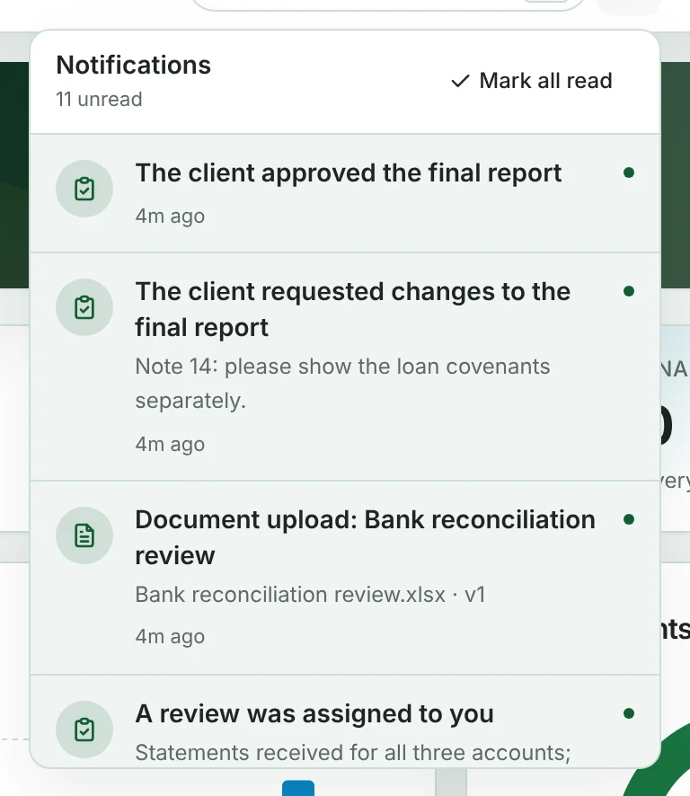
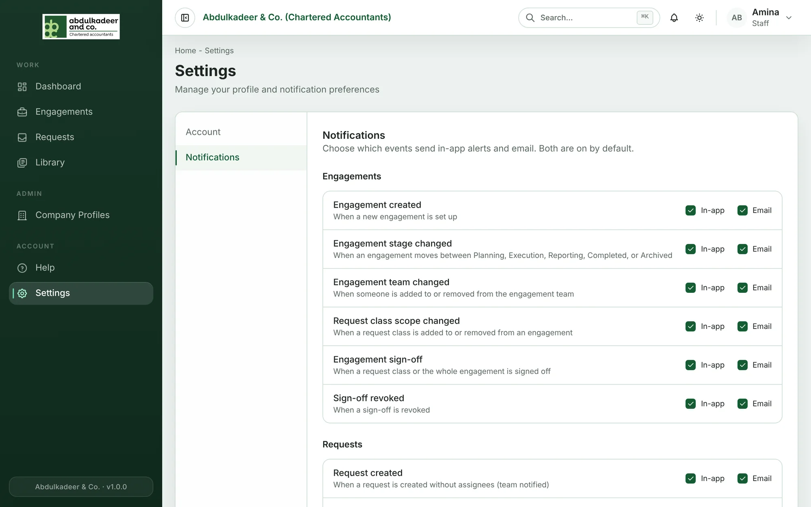

The portal tells you when something needs you — a request assigned to you, a client upload to review, a report to approve, a library item reported, and so on.

## In the app

The **bell** at the top right shows a red number when you have unread notifications. Click it to see them, newest first.

- Click a notification to go straight to the thing it's about. It's marked as read.
- **Mark all read** clears the count.
- Unread notifications have a dot and a shaded background.

The list refreshes on its own every minute or so.

Some notifications carry a download — for example, when a ZIP of documents you asked for is ready. Clicking it starts the download.

## By email

Most notifications are also sent by email, with a link back to the right page in the portal.

## Choosing what you get

1. Go to **Settings** (in the menu, or click your name and choose **Account settings**), then **Notifications**.
2. Each kind of notification is listed under its area — **Engagements**, **Requests**, **Documents**, **Collaboration**, **Reviews**, **Reports** and **Library** — with a short description.
3. Tick or untick **In-app** and **Email** for each one. Changes are saved straight away.

Both are on by default.

> [!NOTE]
> Account emails — your invitation, password resets and password-change confirmations — are always sent and can't be turned off.
