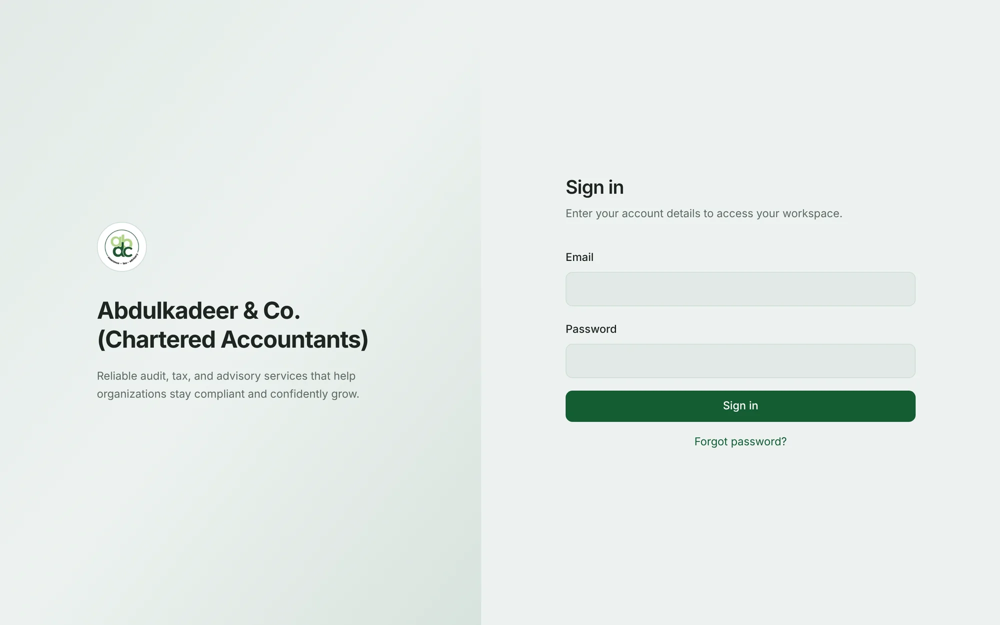
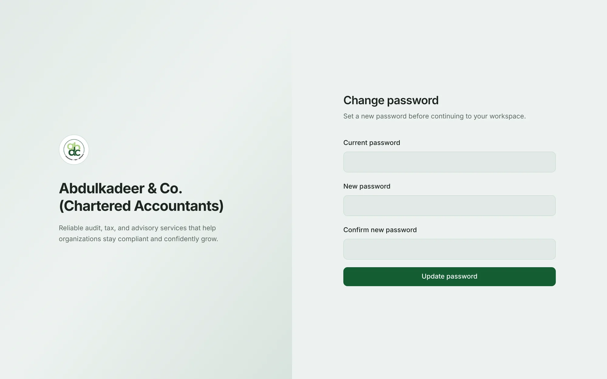
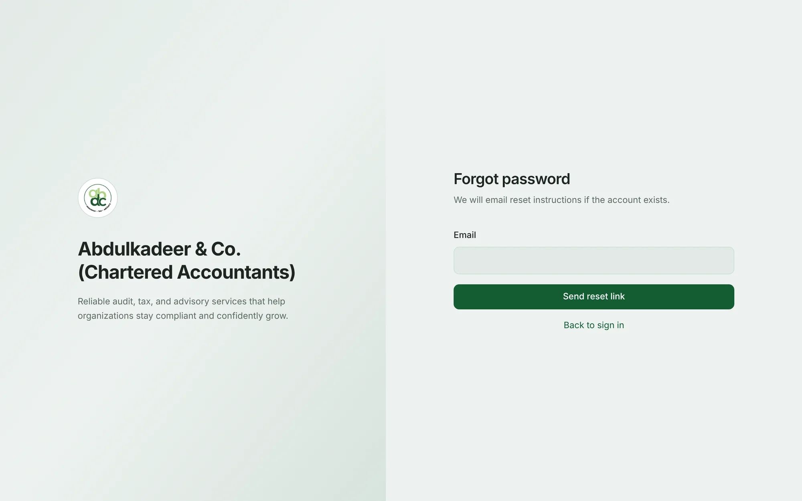

## Your account

You don't sign up yourself. An administrator creates your account, and you receive an email titled **Your ABDC Share account is ready** with your email address, a temporary password and a link to the sign-in page.

## Signing in

1. Open the link from the email (or the portal's address).
2. Enter your **Email** and **Password**.
3. Click **Sign in**.

You arrive on your **Dashboard** — or, if you followed a link to a particular page, on that page.

> [!TIP]
> If several sign-in attempts fail in a row, wait a minute before trying again — repeated attempts are slowed down to protect your account.

## Setting your own password the first time

The first time you sign in with a temporary password, the portal asks you to choose your own before you go any further.

1. In **Current password**, enter the temporary password from the email.
2. Enter your **New password** — at least 8 characters — and type it again in **Confirm new password**.
3. Click **Update password**.

You're signed out and asked to sign in again with your new password. The same happens if an administrator resets your password.

## Forgot your password?

1. On the sign-in page, click **Forgot password?**
2. Enter your email address and click **Send reset link**.

   

3. Open the email titled **Reset your ABDC Share password** and click the link. It works once, for about an hour.
4. Enter a new password (at least 8 characters), confirm it, and click **Reset password**.
5. Sign in with the new password.

For your security the portal always says a link has been sent, whether or not the email address has an account. If nothing arrives within a few minutes, check your junk folder, then ask an administrator — they can also reset your password for you.

> [!NOTE]
> Resetting or changing your password signs you out everywhere you were signed in, including on your phone.

## Signing out

Click your name at the top right and choose **Sign Out**.

## Can't sign in at all?

- Check you're using the email address the invitation was sent to.
- If your account has been deactivated, you'll need an administrator to reactivate it.
