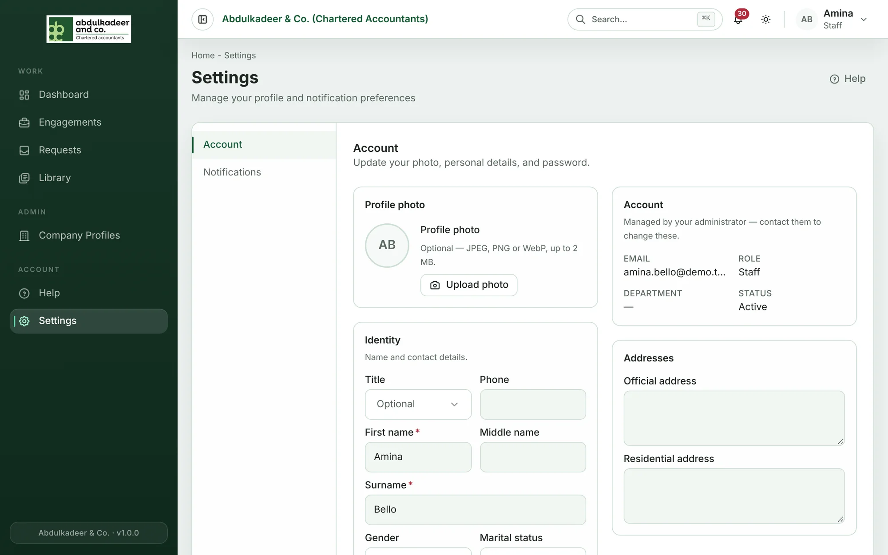
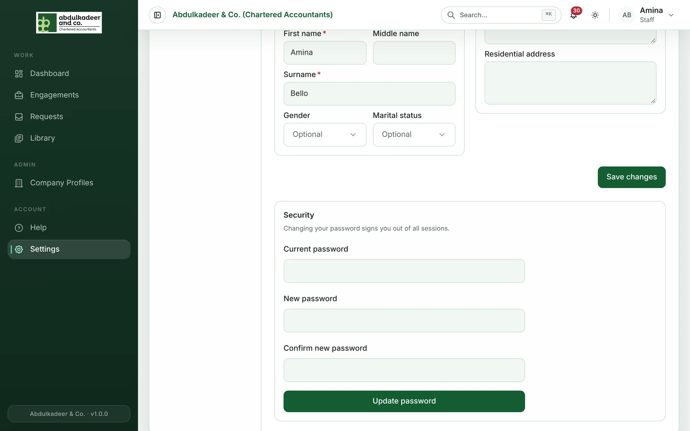

Open **Settings** from the menu (or click your name at the top right and choose **Account settings**). The **Account** page has your profile; **Notifications** has your notification choices.

## Your profile

- **Profile photo** — upload a photo; it appears next to your name across the portal.
- **Identity** — title, first name, middle name, surname, phone, gender and marital status. First name and surname are required.
- **Addresses** — official and residential address.

Click **Save changes** when you're done.

## Details only an administrator can change

The **Account** box shows your **Email**, **Role** (and partner designation, if you have one), **Department** and **Status**. These are managed by your administrator — contact them if something is wrong.

## Changing your password

The **Security** section at the bottom of the page lets you change your password:

1. Enter your **Current password**.
2. Enter a **New password** (at least 8 characters) and **Confirm new password**.
3. Click **Update password**.

Changing your password signs you out of all sessions, including on other devices; sign in again with the new one. If you've forgotten your current password, use [Forgot password?](help:signing-in#forgot-your-password) on the sign-in page instead.
