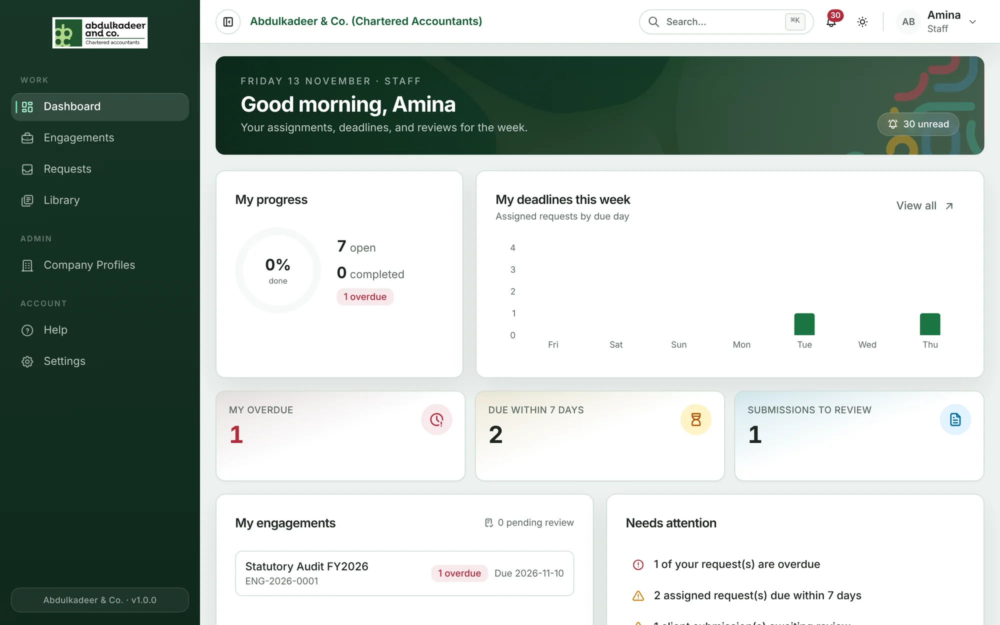
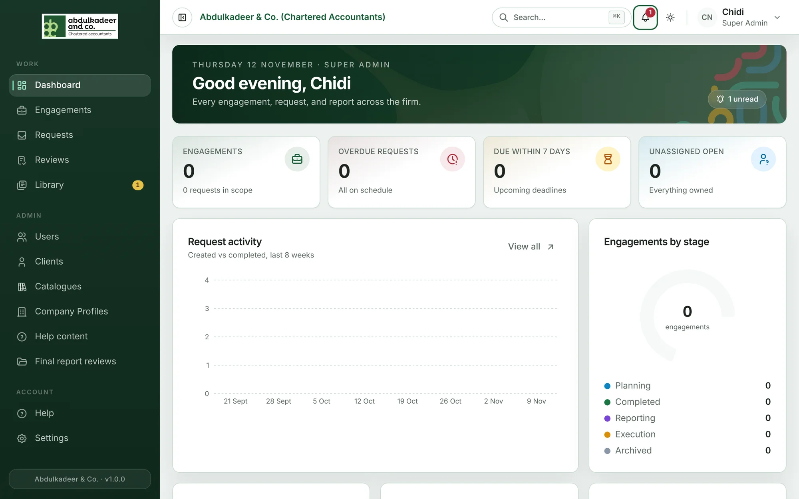

The **Dashboard** is the first page you see after signing in. Its greeting shows the date and your role, and the rest is tailored to what you do. Most figures and items are links — click one to jump to the work behind it.

## Staff

- **My progress** — how many of the requests assigned to you are open or completed, and whether any are overdue.
- **My deadlines this week** — your assigned requests by due day. **View all** opens your requests.
- **My overdue**, **Due within 7 days** and **Submissions to review** — the three numbers to keep at zero.
- **My engagements** — the engagements you're on, and how many items are pending review.
- **Needs attention** — the most urgent items, such as overdue requests.

## Super Admins

The firm-wide view: **Engagements**, **Overdue requests**, **Due within 7 days** and **Unassigned open** requests; **Request activity** over recent weeks; **Engagements by stage**; **Delivery health**; **Team workload**; and **Final reports** in the client review cycle. Partners and the Principal Partner also see their **Reports**.

## Clients

**Waiting on you**, **Returned for update** and **Reports to review** at the top; then **Your document pipeline** (what you've sent and where it stands) and **Your engagements**. If a final report is waiting for your approval, a banner says so.

## Guests

Your **Principal reporting** status, **My reports** (drafts, submitted and reviewed) and a short **How it works**.

## Platform Admins

The health of the system: **Users**, accounts that **Must change password**, **Inactive accounts**, **Audit events (7d)**, **Users by role**, **Platform activity** and **Catalogue health**.
