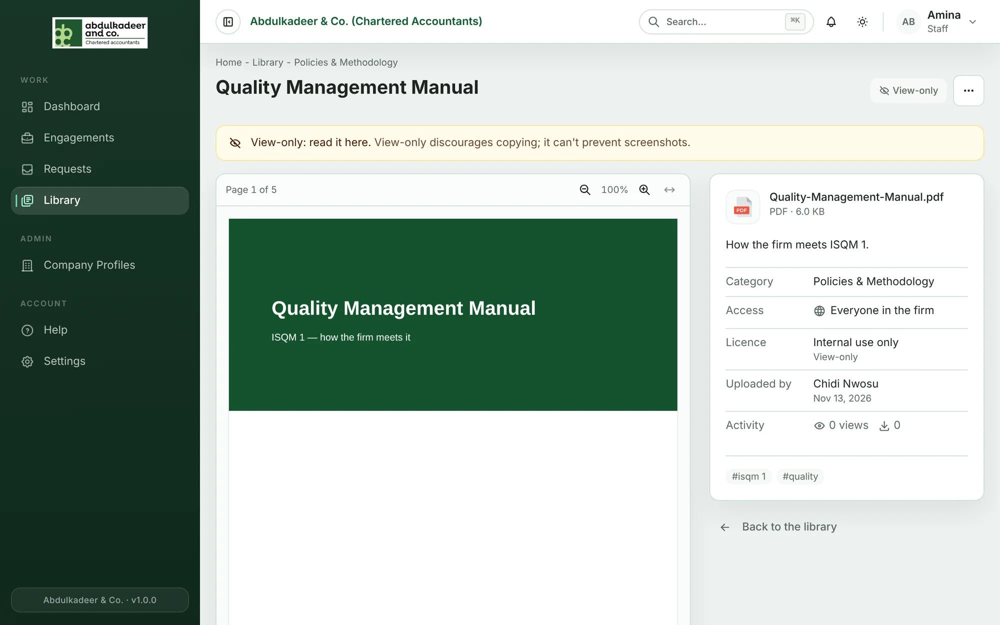

Every item has three settings that decide who can see it and what they may do with it. You choose them when you upload, and you can change them later with **Edit details**.

## Who can see this

| Choice | Who can find and open it |
| --- | --- |
| **Everyone in the firm** | All staff. This is the default. |
| **Specific departments** | People in the departments you pick — plus you (the uploader) and the library curators. |

Choose **Specific departments** for anything that should stay with one team, such as material that mentions a client and can't be anonymised, or internal tax guidance meant for the Tax team.

Department-only items don't show up at all for anyone else — not in browsing, search or collections. The item page shows a padlock and the department names under **Access**.

> [!NOTE]
> Clients and guests never see the Library. It is for staff only.

If every department an item is restricted to is later deactivated, only the uploader and curators can still see it until a curator sorts it out.

## Licence

| Licence | Meaning |
| --- | --- |
| **Internal use only** | For staff of the firm. The default. |
| **Licensed material** | Bought or subscribed to — do not share outside the firm. Readers see a reminder on the item page. |
| **Free to share** | Public material that may be shared with clients. |

Use the optional **Licence note** for anything readers should know, such as *Subscription — internal use only* or the licence terms.

## View-only

Tick **View-only** when people should read the item in the browser but not download it — for example, a manual that must always be read in its latest version.

- Readers see a **View-only** badge and no **Download** button.
- You (the uploader) and the curators can still download it.

> [!WARNING]
> View-only discourages copying; it can't prevent screenshots. If a file must not leave a team, restrict it to that team's departments as well.
