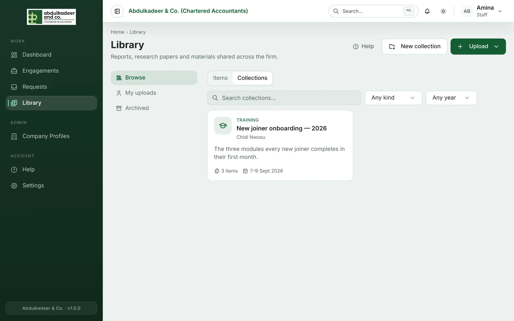
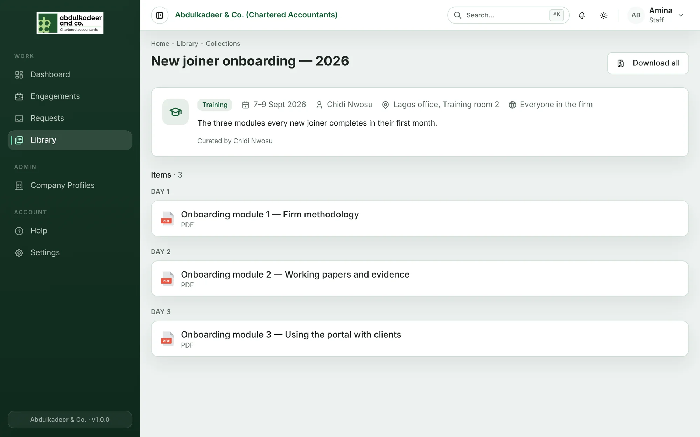
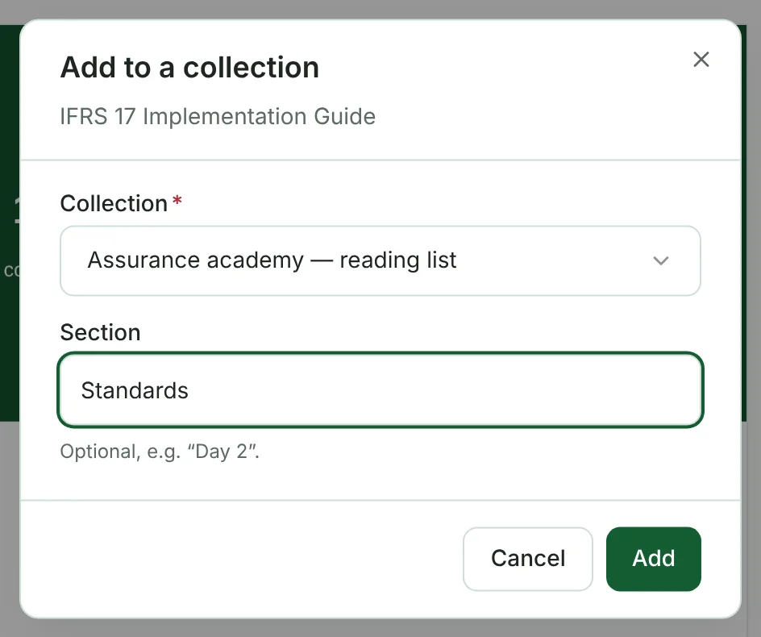

A **collection** gathers related library items in one place — the slides and handouts from a training, the papers from a conference, or the material for a project. The items stay in the Library as normal; the collection is just a well-organised view of them.

## Finding collections

In the **Library**, switch from **Items** to **Collections**. Each card shows the type (Training, Workshop, Conference, Project, Programme or Other), the dates, and how many items it holds.

Open a collection to see its details — dates, facilitator or lead, venue, and who can see it — and its items, grouped into sections such as *Day 1*, *Day 2*.

If some items are restricted to departments you're not in, you'll see a note such as *2 more items you don't have access to*. Items always keep their own access settings.

## Downloading a whole collection

Click **Download all**. The portal prepares a ZIP of every file you're allowed to download in the collection and sends you a notification (**Library download ready**) with the link when it's done. A ZIP can hold up to 200 files.

## Creating a collection

1. In the **Library**, click **New collection**.
2. Give it a **Title** (for example *IFRS 17 training — March 2026*) and choose the **Type**.
3. Optionally add a **Description**, the **Starts** and **Ends** dates, the **Facilitator / lead**, the **Venue** and a **Link** (it must start with https://).
4. Choose who can see it: **Everyone in the firm** or **Specific departments**.
5. Click **Create collection**. You're taken to the new, empty collection.

## Adding items

From the collection page (you must own it, or be a curator):

- **Upload files** — upload new files straight into the collection. They are added to the Library at the same time.
- **Add existing items** — search the Library and pick items that are already there.

Both let you choose a **Section** so the items are grouped, for example by day or by topic.

From any item, you can also use **⋯ More actions → Add to collection** and pick one of your collections.

## Organising and tidying up

- Use the up and down arrows on an item to change its order, and the **×** to take it out of the collection (the item itself stays in the Library).
- **Edit details** changes the title, dates and other details.
- **Archive** hides the collection from the Library. Its items are not affected. An archived collection can be restored, or deleted for good.
