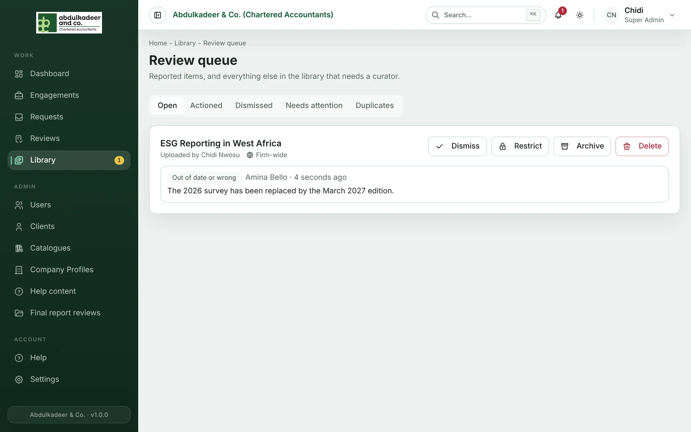
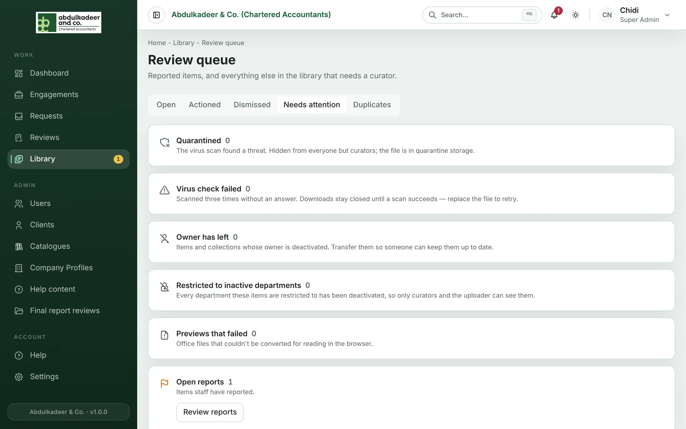
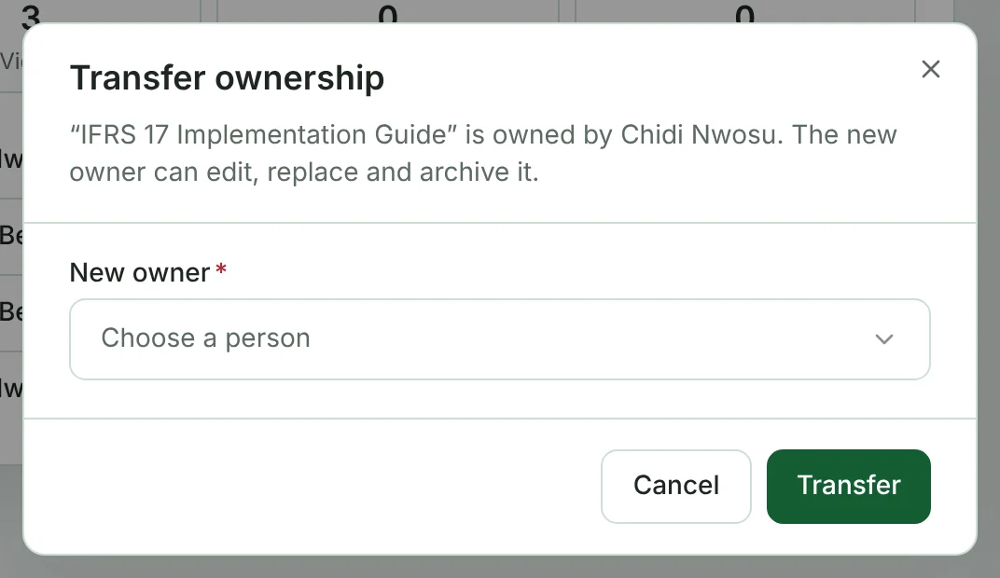

Platform Admins and Super Admins are **library curators**. Curators can see every item (including department-only ones), edit any item or collection, act on reports, transfer ownership, and permanently delete archived items.

## The review queue

Click **Review queue** at the top of the Library. The number next to it (and on **Library** in the menu) is the count of open reports.

Each reported item shows every report against it: the reason, who reported it, when, and their note. Decide what to do:

| Action | What it does |
| --- | --- |
| **Dismiss** | Nothing wrong — leave the item as it is. |
| **Restrict** | Keep it, but only for the departments you choose. |
| **Archive** | Hide it from the library. The uploader can still see it. |
| **Delete** | Remove it permanently. |

Add a **Note to the reporter** if it helps. All reports on that item are closed and each reporter is told what you decided. The **Actioned** and **Dismissed** tabs keep the history.

## Needs attention

The **Needs attention** tab collects everything else that needs a curator:

- **Quarantined** — the virus scan found a threat. The item is hidden from everyone but curators and the file is kept in quarantine storage. Delete it, or ask the uploader for a clean copy.
- **Virus check failed** — the file was scanned three times without an answer. Downloads stay closed until a scan succeeds; replacing the file starts a new scan.
- **Owner has left** — items and collections whose owner has been deactivated. Use **Transfer all…** to hand everything to a colleague in one go.
- **Restricted to inactive departments** — every department the item is restricted to has been deactivated, so only curators and the uploader can see it. Edit its access.
- **Previews that failed** — Office files that couldn't be converted for reading in the browser (for example, password-protected files). Ask the uploader for a PDF version.
- **Open reports** — a shortcut to the review queue.

## Duplicates

The **Duplicates** tab lists files that have been uploaded more than once (the same file content, whatever the name). Archive the extra copies, or keep both if they serve different purposes.

## Transferring ownership

On any item or collection, choose **⋯ More actions → Transfer ownership**, pick the **New owner** and click **Transfer**. The new owner can then edit, replace and archive it. Only active staff who can upload to the Library can become owners.

## Deleting

Delete is permanent and is only offered for items that are archived (or quarantined). Archive the item first, then open it from **Archived** and choose **Delete permanently**.

## Categories

The Library's categories are managed by Platform Admins under **Admin → Catalogues → Library categories**: add a category, rename it, change its order, or deactivate one that's no longer used.
