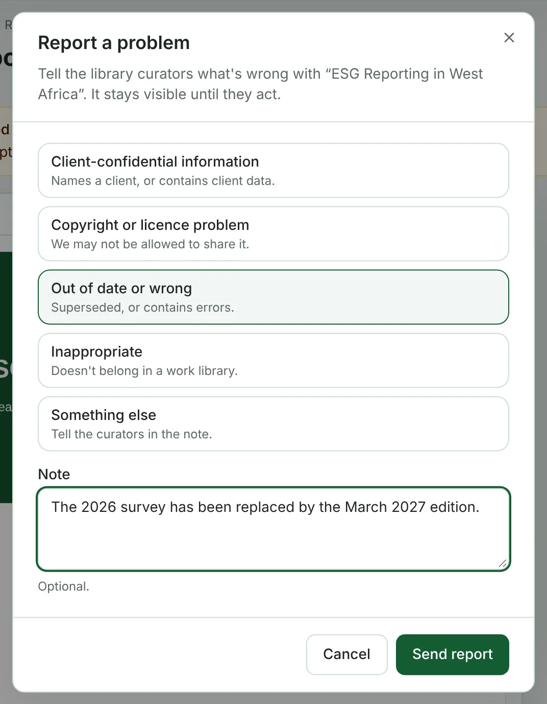

If you spot something wrong with an item — it names a client, it may break a licence, it's out of date, or it simply doesn't belong — report it. The library curators are alerted straight away.

## Report an item

1. Open the item and click **⋯ More actions → Report a problem**.
2. Choose what the problem is:
   - **Client-confidential information** — names a client, or contains client data.
   - **Copyright or licence problem** — we may not be allowed to share it.
   - **Out of date or wrong** — superseded, or contains errors.
   - **Inappropriate** — doesn't belong in a work library.
   - **Something else** — tell the curators in the note.
3. Add a **Note** saying what's wrong, for example *Page 4 names the client*. It's optional, except for **Something else**.
4. Click **Send report**.

## What happens next

- The item stays visible until a curator acts on it.
- A curator decides whether to leave it as it is, restrict it to certain departments, archive it, or delete it.
- You get a notification (**Your library report was resolved**) telling you what they decided, with any note they added.

You can only report the same item once while your report is open.

> [!WARNING]
> If a file exposes a client's confidential information, report it as **Client-confidential information** — and if it's urgent, tell a curator directly as well.
