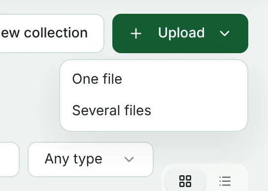
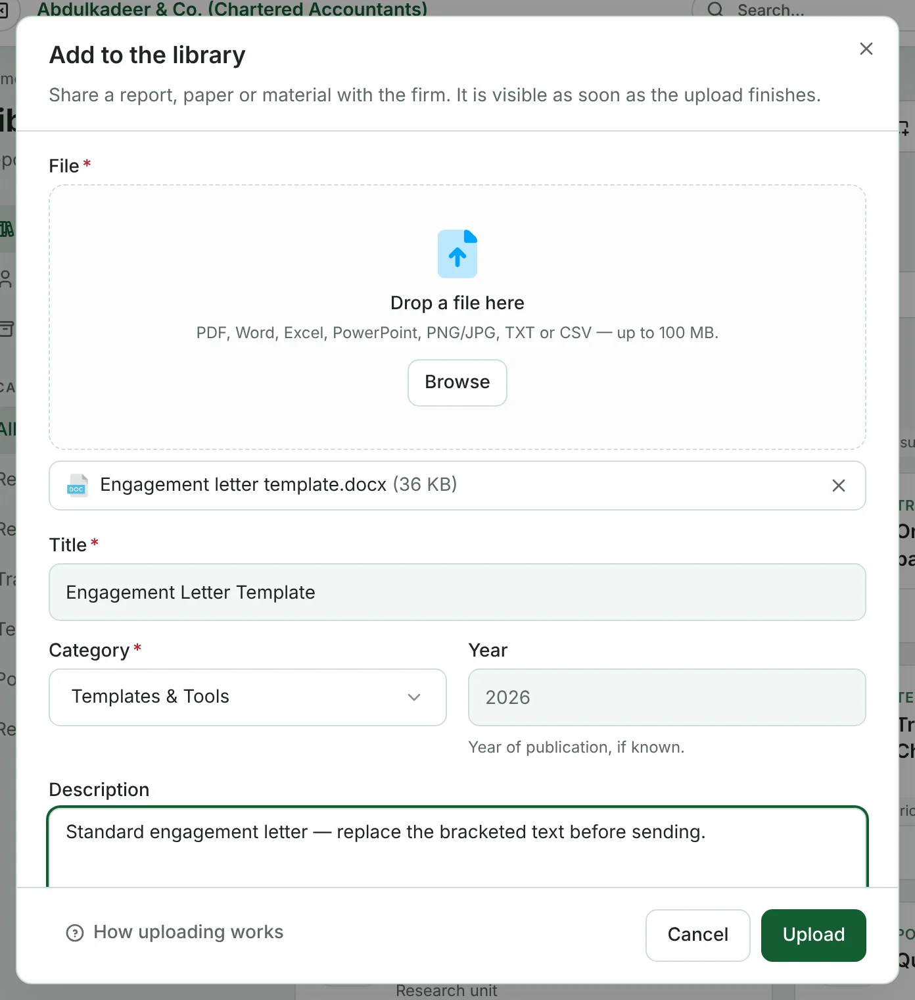
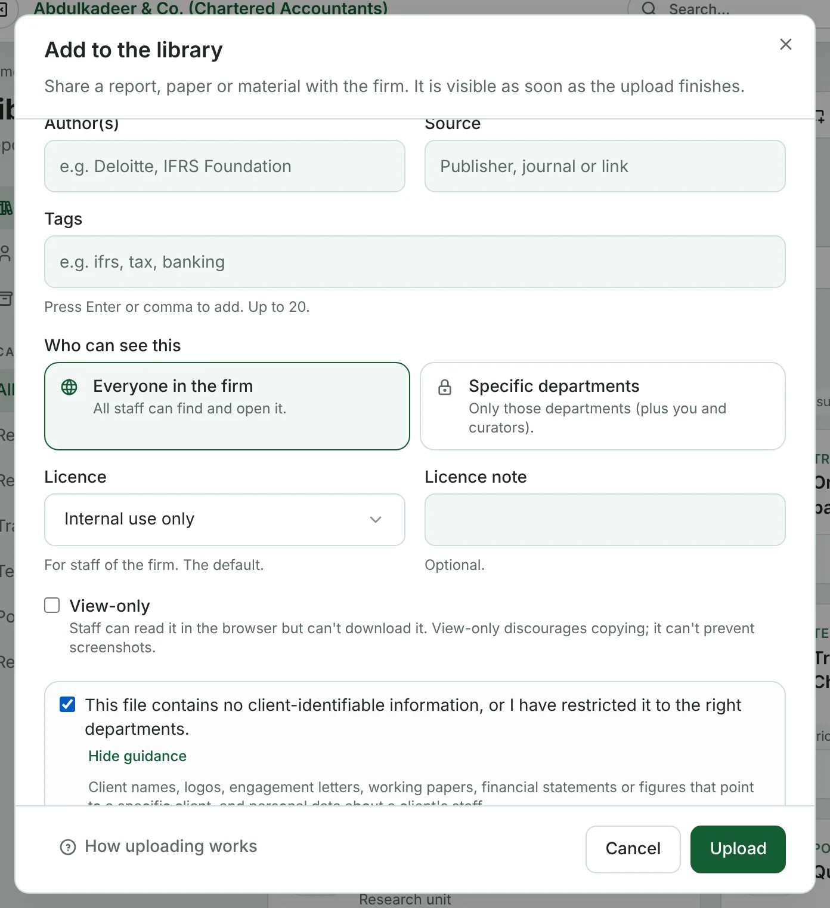
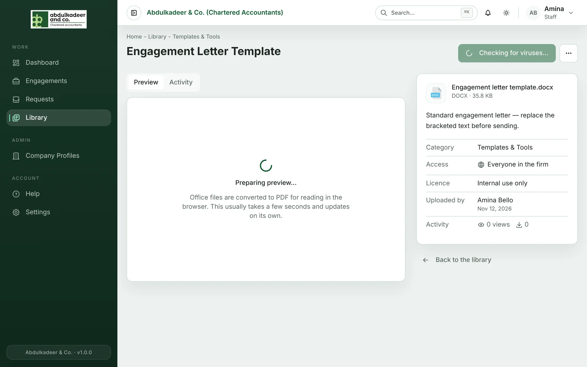
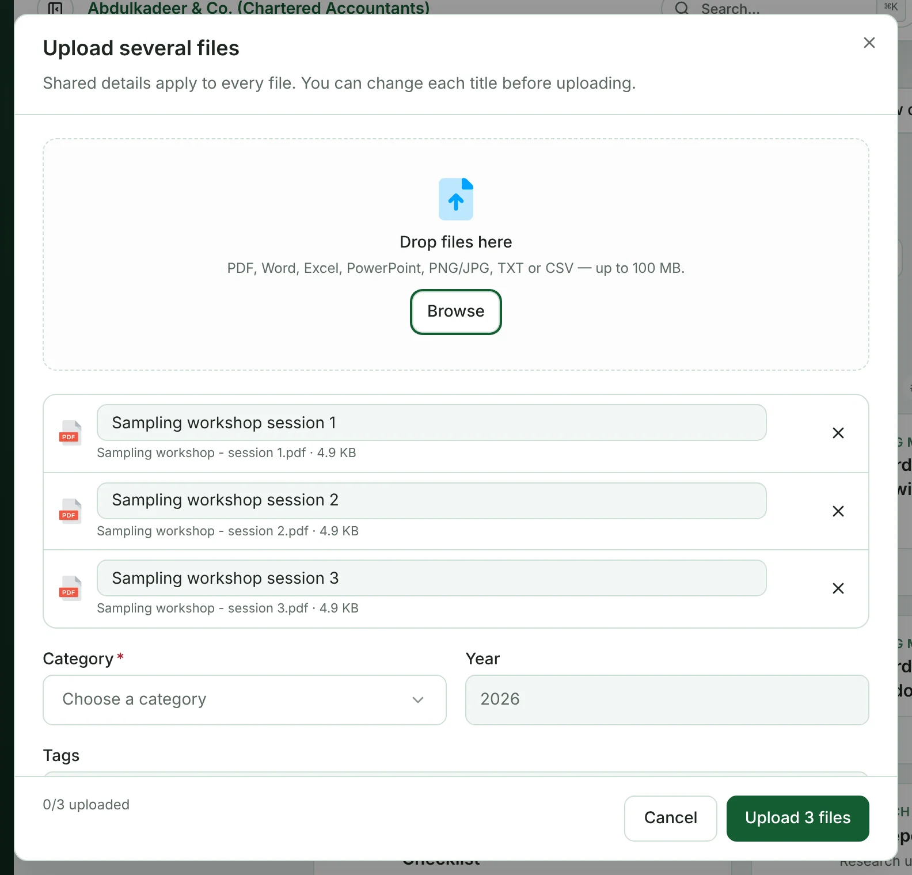

Anyone on staff can add material to the Library. Files you upload are visible as soon as the upload finishes (downloads open once the virus check has passed).

**Accepted files:** PDF, Word, Excel, PowerPoint, PNG/JPG, TXT or CSV, up to 100 MB each.

## Upload one file

1. In the **Library**, click **Upload** and choose **One file**.

   

2. Drag the file onto **Drop a file here**, or click **Browse**.
3. Check the **Title** — it is filled in from the file name. Make it something a colleague would search for.
4. Choose a **Category**. Add the **Year** of publication if you know it, and a short **Description**.

   

5. Optionally fill in **Author(s)** and **Source** (publisher, journal or link), and add **Tags** — press Enter or a comma after each one, up to 20.
6. Under **Who can see this**, choose **Everyone in the firm** or **Specific departments**. Set the **Licence**, and tick **View-only** if people should read it but not download it. All of this is explained in [Who can see an item, licences and view-only](help:library-access-and-licences).
7. Tick the declaration: *This file contains no client-identifiable information, or I have restricted it to the right departments.* You can't upload without it.

   

8. Click **Upload**. A progress bar shows the upload; when it finishes you'll see **Added to the library**, with an **Open** link to the new item.

## The declaration — what counts as client-identifiable

Client names, logos, engagement letters, working papers, financial statements or figures that point to a specific client, and personal data about a client's staff.

If a file contains any of these, anonymise it first, or choose **Specific departments** so only the people who need it can see it. If you are unsure, ask a library curator before uploading.

> [!WARNING]
> Working papers and documents for a particular engagement belong in that engagement, not in the Library.

## Upload several files at once

1. Click **Upload** and choose **Several files**.
2. Drop the files onto **Drop files here** or click **Browse**. Each file gets its own row — change any title there, or remove a file with **×**.
3. Fill in the shared details once: **Category**, **Year**, **Tags**, who can see them, licence and view-only. They apply to every file.
4. Tick the declaration and click **Upload _n_ files**.

The counter at the bottom shows how many have finished. If any file fails (for example, your connection drops), the others still upload; click **Retry** to send the ones that didn't make it.

## "Already in the library"

The portal recognises a file that is already in the Library, even under a different name. You'll see **Already in the library** with a link to the existing item. Open it instead — or carry on to upload anyway if yours is genuinely different (a newer edition, say).

## Uploading straight into a collection

From a collection you own, use **Upload files** to add new files directly to it, optionally under a **Section** such as *Day 1*. See [Collections](help:library-collections).
