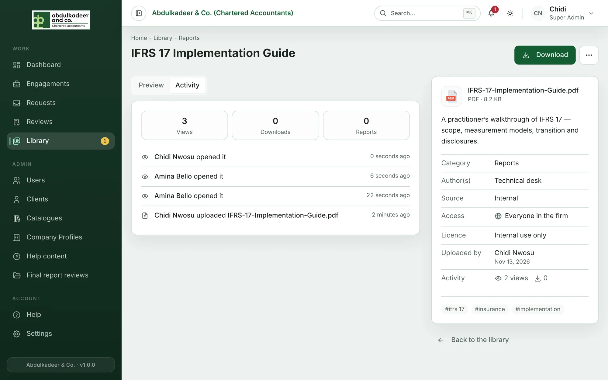

You can keep the items you uploaded up to date at any time. Find them under **My uploads** in the Library.

All of the actions below are in the **⋯ More actions** menu on the item page.

## Edit details

**Edit details** changes the title, category, year, description, authors, source, tags, who can see it, the licence and view-only. Changes take effect straight away.

## Replace the file

When there is a newer version of the document, use **Replace file** rather than uploading it again. The title, tags and other details stay the same, and so do its place in collections and its view and download counts; the old file is removed.

1. Choose **Replace file**.
2. Drop the new file onto **Drop the new file here** (same file types and size limit as uploading).
3. Tick the declaration again and click **Replace**.

The new file is virus-checked before it can be downloaded, just like a new upload.

## Archive and restore

**Archive** hides an item from the Library — useful when it's out of date but you might need it again. It stays out of browsing, search and collections.

- Find your archived items under **Archived** in the Library.
- Open one and choose **Restore** to put it back.

Only library curators can delete an item permanently, and only once it is archived.

## Activity

The **Activity** tab on your item's page shows its history: when it was uploaded, viewed, downloaded, edited, replaced, added to a collection, reported or archived, and by whom. It is visible to you and to the curators.

## If you leave the firm

When someone's account is deactivated, their items and collections stay in the Library. Curators can transfer them to a colleague so someone keeps them up to date.
