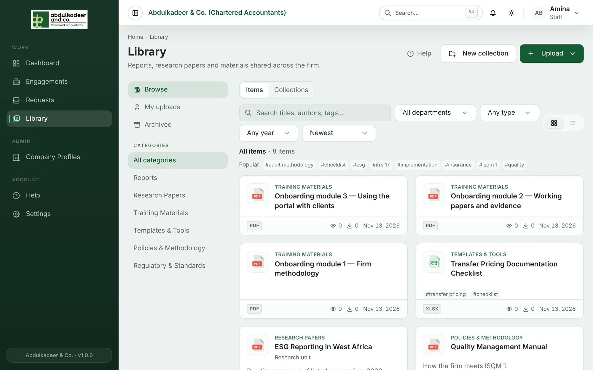
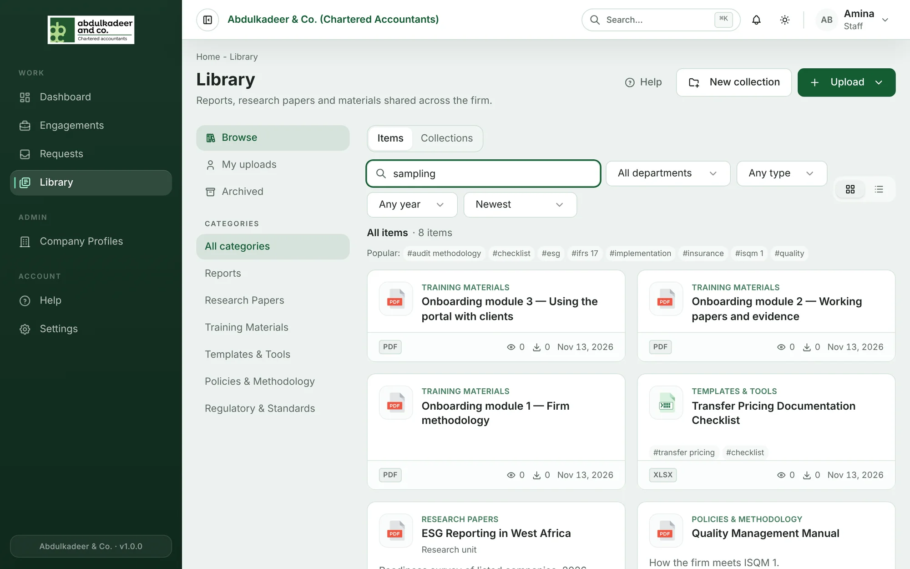
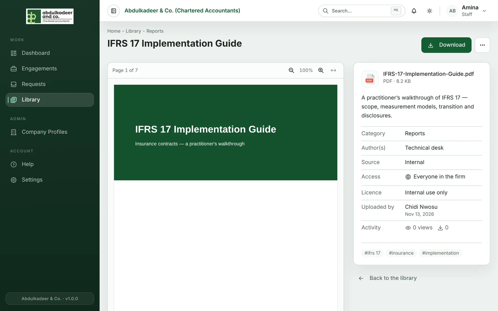
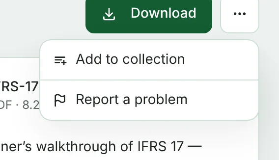

The **Library** is the firm's shared shelf: reports, research papers, training materials, templates and tools, policies and methodology, and regulatory material. Anything in it can be read in the browser, and most of it can be downloaded.

Open it from **Library** in the left-hand menu.

## What you'll see

- **Browse**, **My uploads** and **Archived** (top left) switch between everything you can see, the items you uploaded, and archived items.
- **Categories** narrow the list to one shelf, such as *Training Materials* or *Templates & Tools*.
- **Items** and **Collections** (above the list) switch between single files and collections — groups of files from one training, workshop, conference or project. See [Collections](help:library-collections).
- The two small buttons on the right switch between **card view** and **table view**.

Each card shows the category, title, file type, how many times it has been viewed and downloaded, and when it was added.

## Searching

Type in **Search titles, authors, tags…**. The search looks at titles first, then tags and authors, then descriptions, sources and file names, and puts the best matches at the top.

Narrow the results with the filters next to the search box:

| Filter | What it does |
| --- | --- |
| Department | Only items restricted to that department |
| Any type | PDF, Word, Excel, PowerPoint, Image, or Text / CSV |
| Any year | The year the material was published |
| Sort | Newest, Best match, Title A–Z, Most viewed, Most downloaded |

Click a tag under **Popular:** to see everything with that tag. Clear the search box and filters to go back to the full list.

> [!TIP]
> You can also find library items from anywhere in the portal: press **Ctrl + K** (or **⌘ K** on a Mac) and start typing. Library matches appear under their own heading.

## Opening an item

Click a card to open the item. PDFs, Word, Excel and PowerPoint files, images and text files are shown right on the page — you don't need to download them to read them.

- Use the zoom buttons above the preview, or the **↔** button to fit the page to the width of the screen. The page counter shows where you are.
- Office files are converted to a PDF preview the first time someone opens them, so you may see **Preparing preview…** for a few seconds.
- The panel on the right shows the category, authors, source, who can see it (**Access**), the **Licence**, who uploaded it and when, and its tags.

## Downloading

Click **Download** at the top right. Two things can stop you:

- **Checking for viruses…** — every new file is scanned first. Downloads open once the check has passed, usually within seconds.
- **View-only** — the uploader chose to let people read it in the browser but not download it. See [Who can see an item, licences and view-only](help:library-access-and-licences).

> [!NOTE]
> Items marked **Licensed material** were bought or subscribed to. Don't share them outside the firm.

## The More actions menu

The **⋯** button next to **Download** holds everything else you can do with the item. What you see depends on your role and whether you uploaded it.

- **Add to collection** — put the item in a collection you own. See [Collections](help:library-collections).
- **Report a problem** — tell the library curators something is wrong. See [Reporting a problem](help:library-reporting).
- **Edit details**, **Replace file**, **Archive** — for your own uploads. See [Looking after your uploads](help:library-your-uploads).
