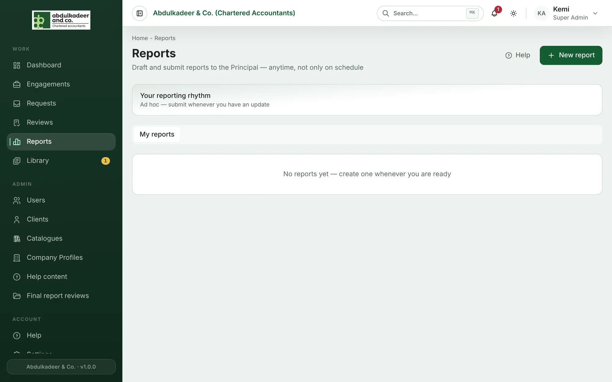

**Partner reports** are short, regular reports to the **Principal Partner**. Each covers a period — usually a week — and has the same sections:

- **Executive summary**
- **Financials** — billings, amounts received and outstanding balances (if financials are allowed for you)
- **Client / engagement updates** — each marked *On track*, *Watch*, *At risk* or *New win*
- **Matters for decision** — each marked *Urgent*, *This period* or *For information*
- **People & capacity** and **Outlook**

## Who's involved

| Who | What they do |
| --- | --- |
| **Partners** | Write and submit reports, and see their own. |
| **Principal Partner** | Sees every report, reviews them, adds notes, and manages who reports (the **roster**). |
| **Guests** | People outside the firm's usual roles, invited by the Principal Partner to submit a report. |
| **Staff or clients on the roster** | Enabled by the Principal Partner to submit reports. |

Partner and Principal Partner are **designations** that a Platform Admin adds to a Super Admin's account.

## Where to find them

Open **Reports** in the menu. Reporters see **My reports**; the Principal Partner also sees **Awaiting review** and **All reports**, plus counts of reports awaiting review, reviewed, drafts and the total.

## Reminders

Each reporter has a preferred **cadence** — Weekly, Monthly, Quarterly or Ad hoc only. On Monday mornings the portal reminds anyone who is due (**Report reminder**). You can always submit a report at any time, whatever your cadence.
