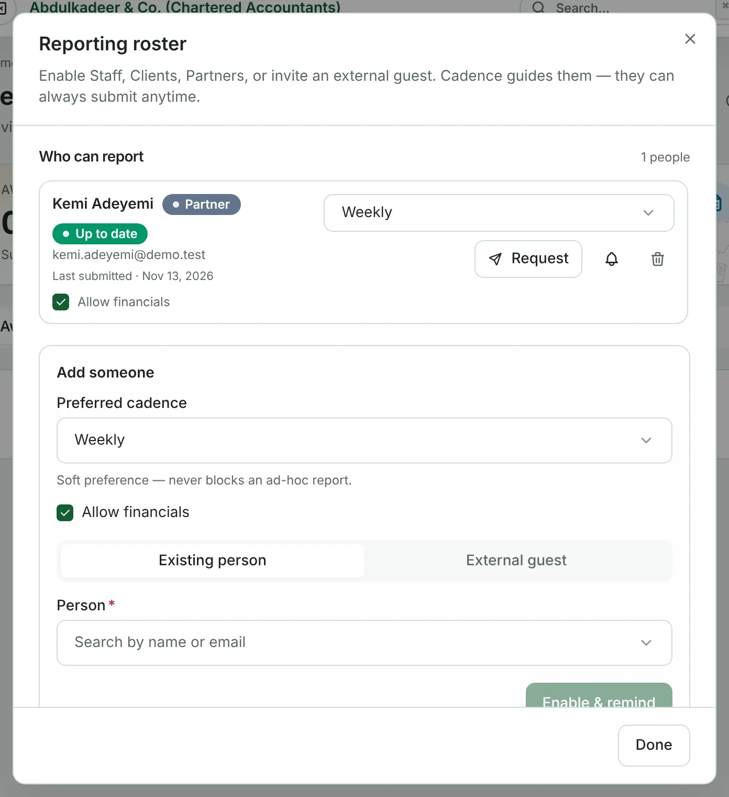
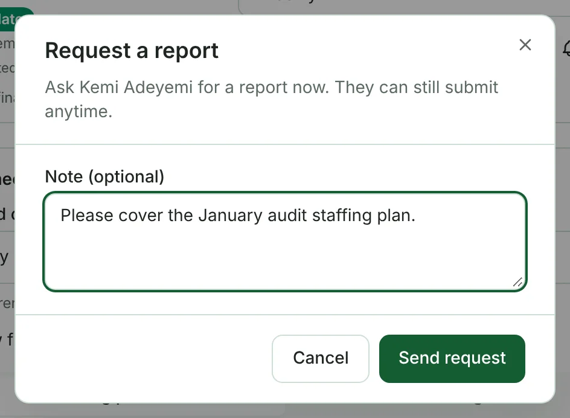
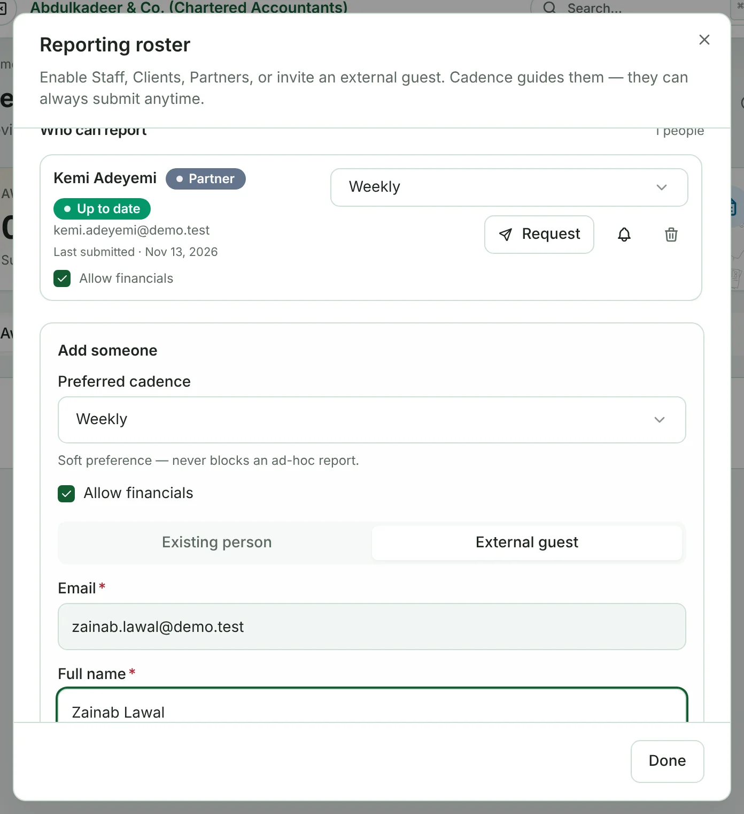
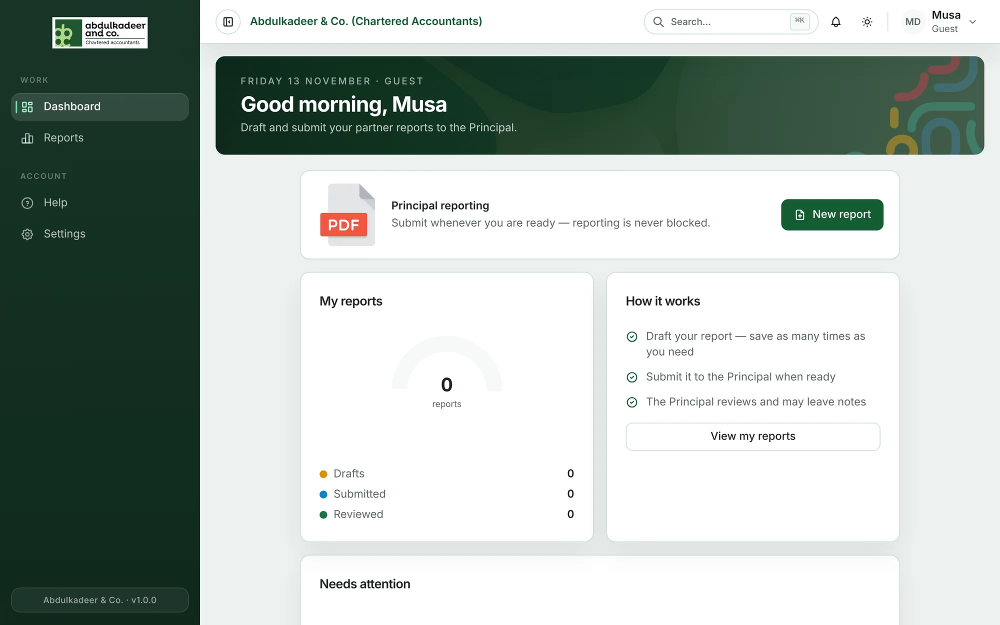

On **Reports**, click **Roster**. **Who can report** lists everyone on the roster, with their kind (Partner, Staff, Client or Guest), whether they're up to date, and when they last submitted.

For each person you can:

- Change their preferred **cadence** — Weekly, Monthly, Quarterly or Ad hoc only. It's a soft preference that drives reminders; it never stops an ad-hoc report.
- Tick or untick **Allow financials** — whether their report includes the Financials step.
- **Request** — ask them for a report now, with an optional note (for example *Please cover WIP and collections for this week*). They're notified and see the request when they open Reports.
- Send a **reminder** (the bell).
- **Remove** them from the roster (the bin).

## Adding someone

Under **Add someone**, choose their **Preferred cadence** and whether to **Allow financials**, then:

- **Existing person** — search for a member of staff, a client contact or a partner, and click **Enable & remind**.
- **External guest** — enter their **Email**, **Full name** and, optionally, **Title**, and click **Invite guest**. The portal creates a Guest account and emails them their sign-in details; they choose their own password the first time they sign in.

Guests only see their own reports.

