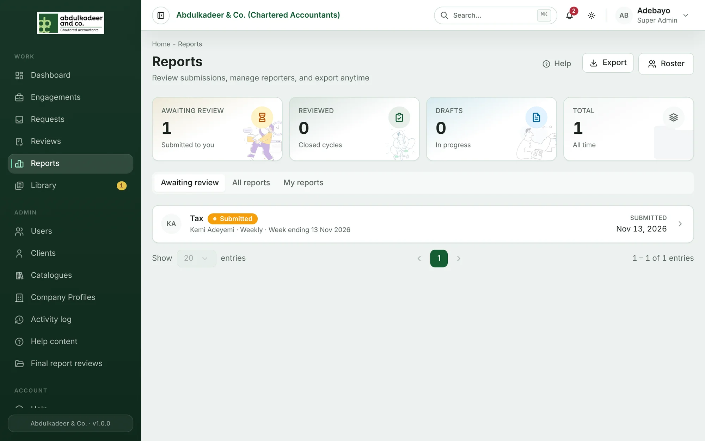
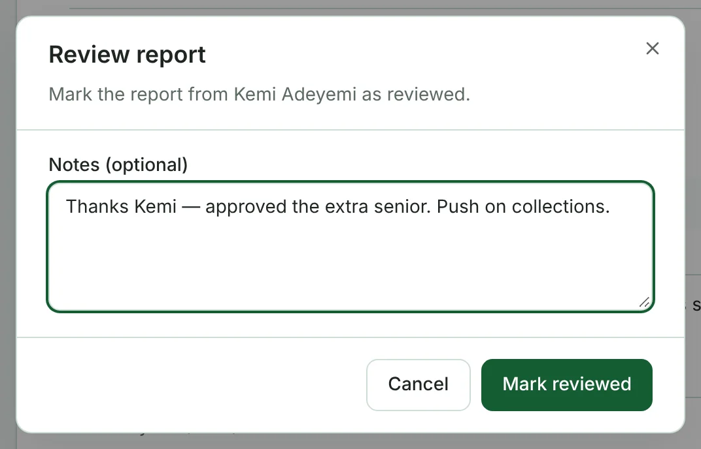
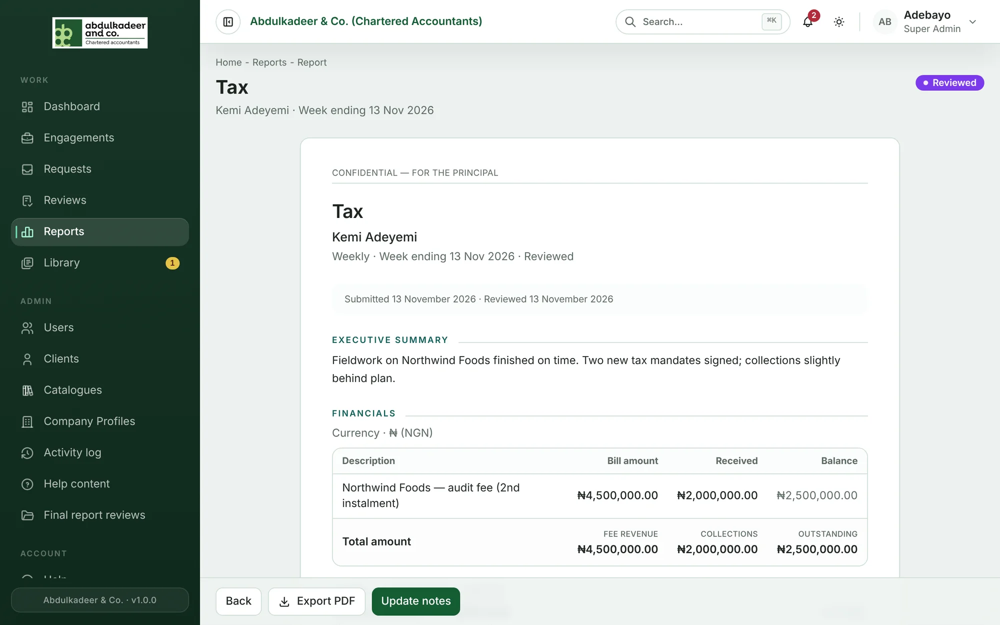

Open **Reports**. **Awaiting review** lists submitted reports you haven't reviewed yet; **All reports** lists everything. The cards at the top count reports awaiting review, reviewed, drafts and the total.

## Reviewing a report

1. Click a report to open it.
2. Click **Review report**, write **Feedback for the reporting officer** if you have any, and click **Mark reviewed**.

The reporter is notified (**Report reviewed**) and the report shows **Reviewed**.

## Principal notes

**Update notes** adds your own **Principal notes** to a report — for example decisions you've taken on its matters for decision.

## Exporting

- **Export PDF** on a report saves it as a PDF.
- **Export** on the Reports page downloads the list as a CSV file.
