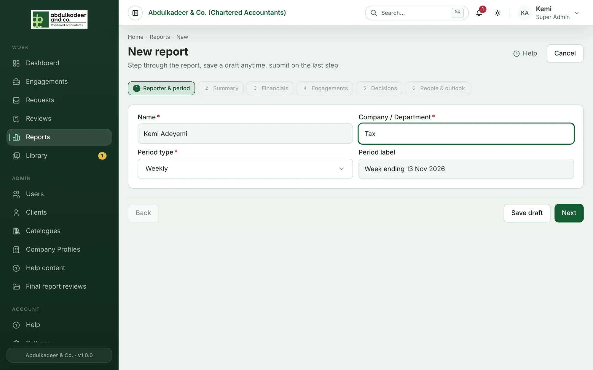
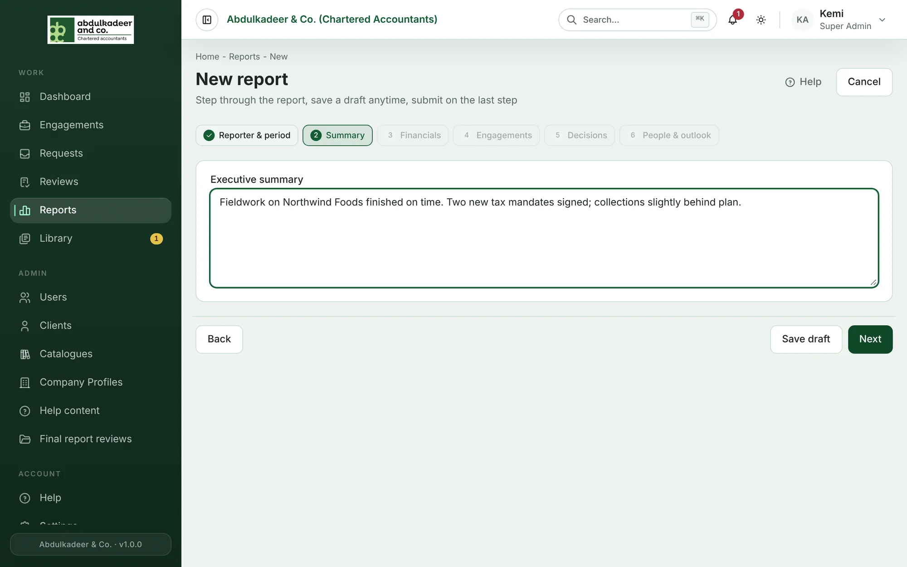
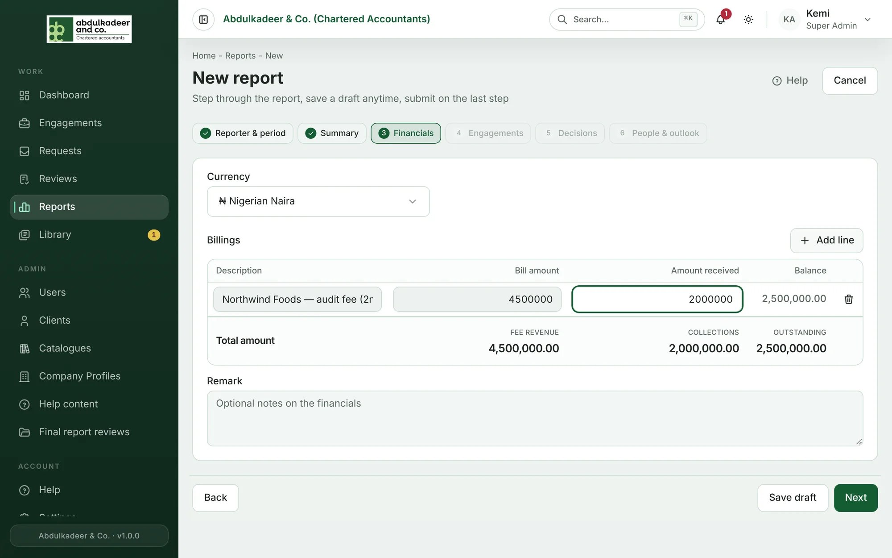
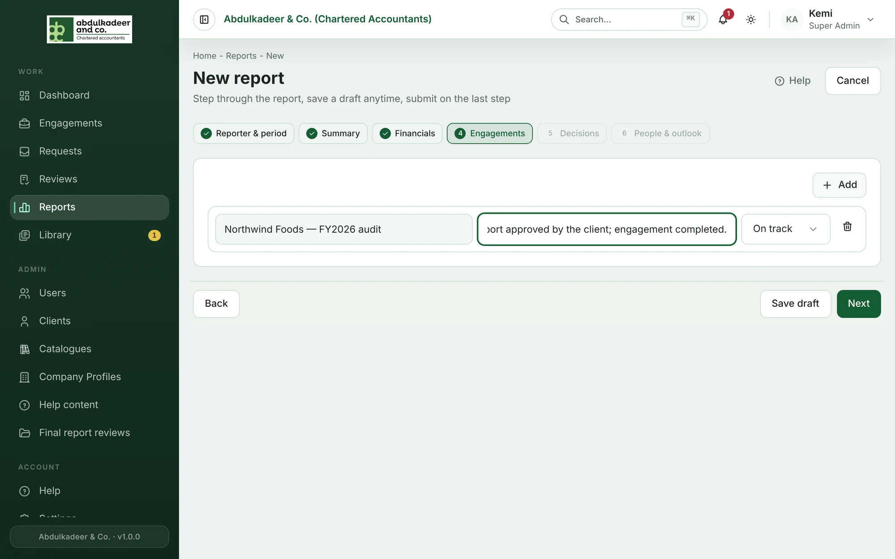
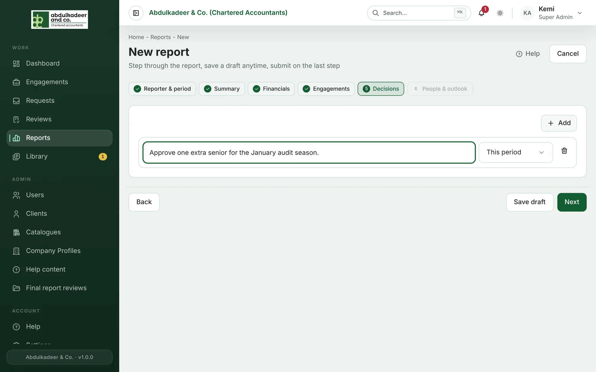
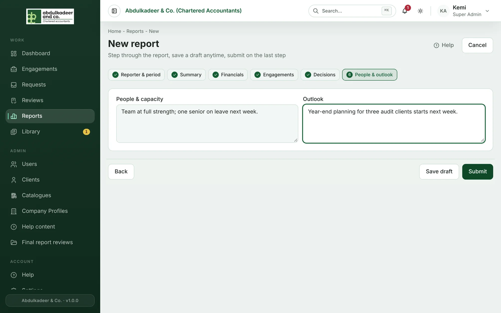
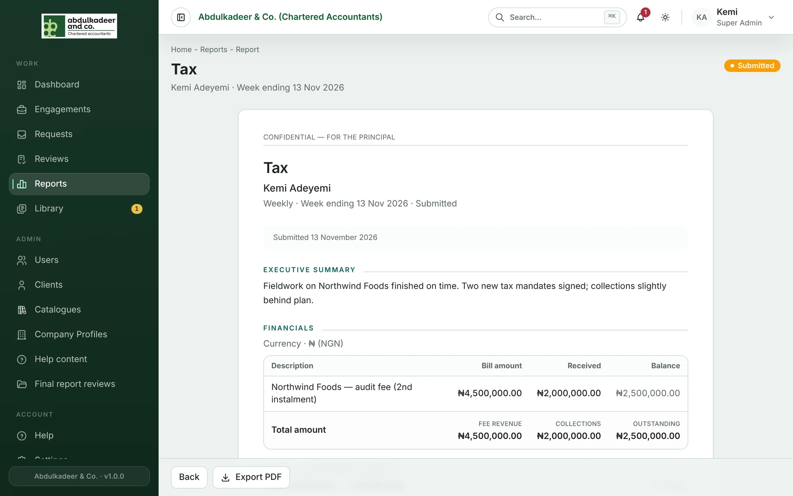

1. Open **Reports** and click **New report** (or **Start report** if the Principal Partner has asked you for one).
2. Work through the steps. **Save draft** keeps your work at any point; **Back** and **Next** move between steps.

## 1. Reporter & period

Your **Name** is filled in. Enter your **Company / Department**, the **Period type** (for example *Weekly*) and a **Period label** such as *Week ending 13 Nov 2026*.

## 2. Summary

The **Executive summary** — the few sentences the Principal Partner should read first.

## 3. Financials

Shown if financials are allowed for you. Choose the **Currency**, then **Add line** for each billing: description, bill amount and amount received. The balance and the totals — **Fee revenue**, **Collections** and **Outstanding** — are worked out for you. Add a **Remark** if needed.

## 4. Engagements

**Add** a line per client or engagement worth mentioning, with an update and a flag: *On track*, *Watch*, *At risk* or *New win*.

## 5. Decisions

**Add** each matter you need the Principal Partner to decide, with its priority: *Urgent*, *This period* or *For information*.

## 6. People & outlook

**People & capacity** (staffing, leave, hiring) and **Outlook** (what's coming up). Then click **Submit**.

The Principal Partner is notified (**Report submitted**), and the report opens as a formatted document. **Export PDF** saves a copy.

> [!NOTE]
> Fields marked with * on a step must be filled in before you can move on.
