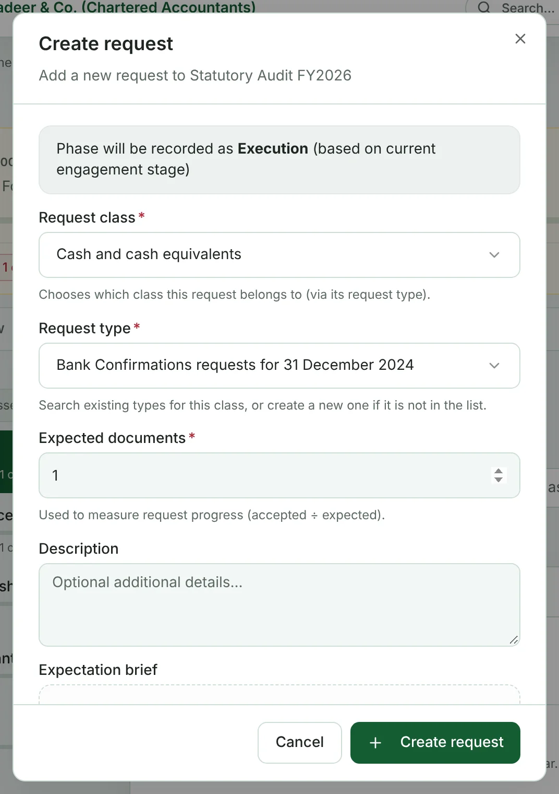
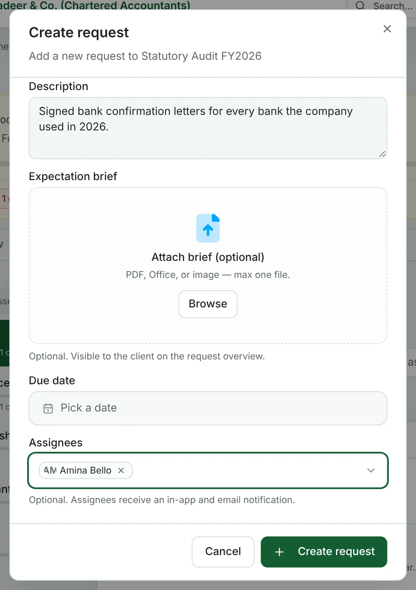

Super Admins and staff on the engagement team can raise requests.

1. Open the engagement and go to the **Requests** tab.
2. Click **Create request**.
3. **Request class** — choose the class (only classes in the engagement's scope are listed).
4. **Request type** — search the types for that class. If what you need isn't there, type a name and create a new type.
5. **Expected documents** — how many files you expect back. Progress is measured against this.

   

6. **Description** — what exactly you need. The client sees this.
7. **Expectation brief** (optional) — attach one file (PDF, Office or image) that shows what you expect, such as a template.
8. **Due date** (optional).
9. **Assignees** (optional) — people from the engagement team. They get an in-app and email notification.
10. Click **Create request**.

The request starts in status **Open** and stage **Not Started**. It's stamped with the engagement's current phase.

> [!TIP]
> When the request is ready for the client, set its status to **Pending Client** so it shows on the client's dashboard. See [Managing requests](help:managing-requests).

## Adding or replacing the brief later

On the request's **Overview**, the **Brief** row has buttons to upload, view, download, replace or remove the brief.
