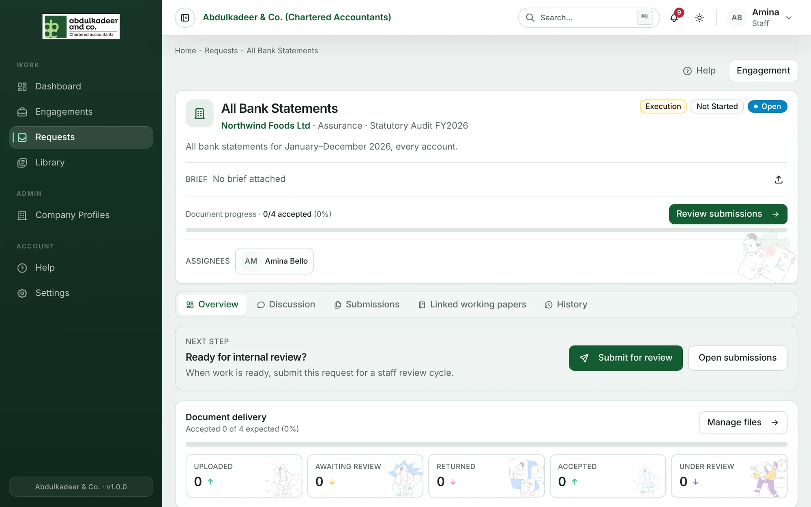

A **request** asks the client for something specific — *All bank statements for 2026*, *Fixed asset register*. Every request belongs to one engagement and one request class, and is based on a **request type** from the firm's catalogue.

## What a request carries

| | |
| --- | --- |
| **Description** | What exactly you need, in plain words. The client sees it. |
| **Brief** | An optional attachment explaining what's expected — a template or example. The client can open it from the request. |
| **Due date** | When it's needed. After this date the request shows as **Overdue**. |
| **Expected documents** | How many files you expect. Progress = accepted files ÷ this number. |
| **Assignees** | The staff responsible. They get the notifications and reminders. |
| **Phase** | Planning, Execution or Reporting — the engagement's stage when the request was raised. |

## Stage and status

Two separate things describe where a request is:

**Stage** is worked out automatically from what has happened (you'll see *(auto)* next to it):

| Stage | When |
| --- | --- |
| **Not Started** | The client hasn't sent anything yet. |
| **Submitted** | The client has sent files and nobody has reviewed them yet. |
| **In Progress** | The team has started accepting or returning files. |
| **Reviewed** | All the expected files are accepted, or the status is Accepted or Closed. |

**Status** is set by the team — staff on the engagement or a Super Admin — and says whose court the ball is in:

| Status | Meaning |
| --- | --- |
| **Open** | Raised, not yet sent to the client. |
| **Pending Client** | Waiting for the client. These requests show on the client's dashboard under **Waiting on you**. |
| **Accepted** | Everything needed has been received and accepted. |
| **Returned** | Sent back to the client for more. |
| **Closed** | No longer needed, or finished. |

The engagement's progress bar is the share of its requests that are **Accepted** or **Closed**.

## Reminders

Every morning the portal reminds assignees about requests due within the next day (**Request due soon**) and those past their due date (**Request overdue**). If a request has no assignees, the engagement team is reminded instead.

## The tabs on a request

- **Overview** — the details above, document progress and **Request details**.
- **Discussion** — messages with the client and the team. See [Discussions](help:request-discussions).
- **Submissions** — what the client has sent, and where you accept or return files. See [Reviewing client files](help:reviewing-client-files).
- **Linked working papers** — working papers linked to this request (staff only).
- **History** — every change to the request, who made it and when.
