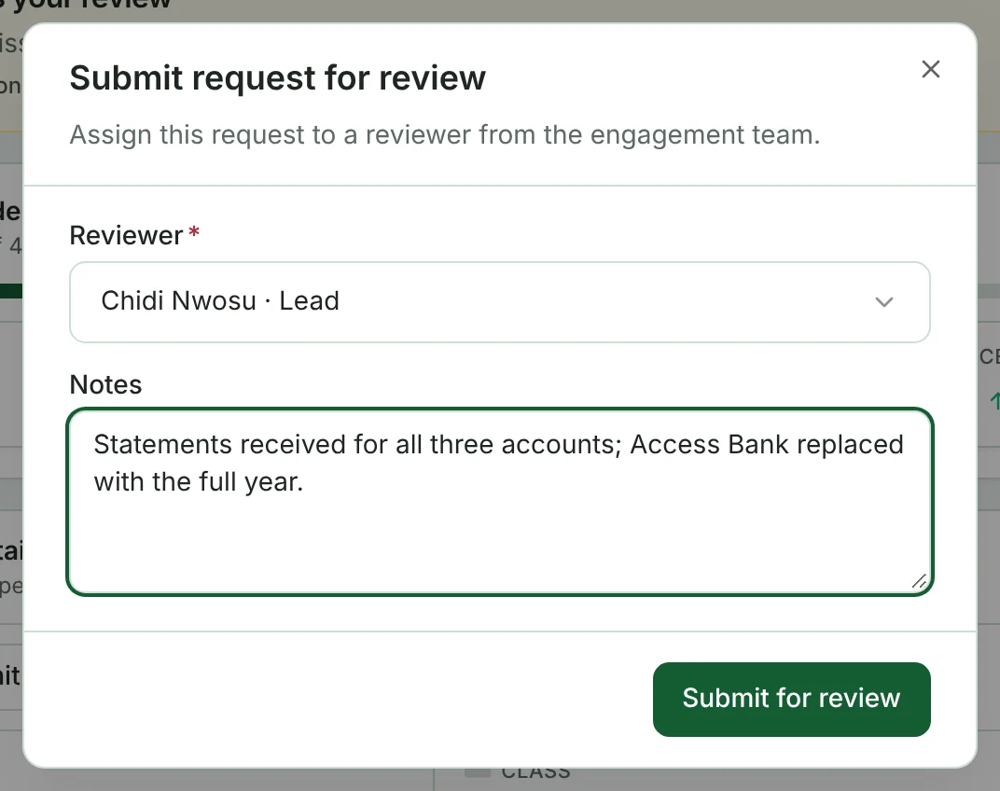
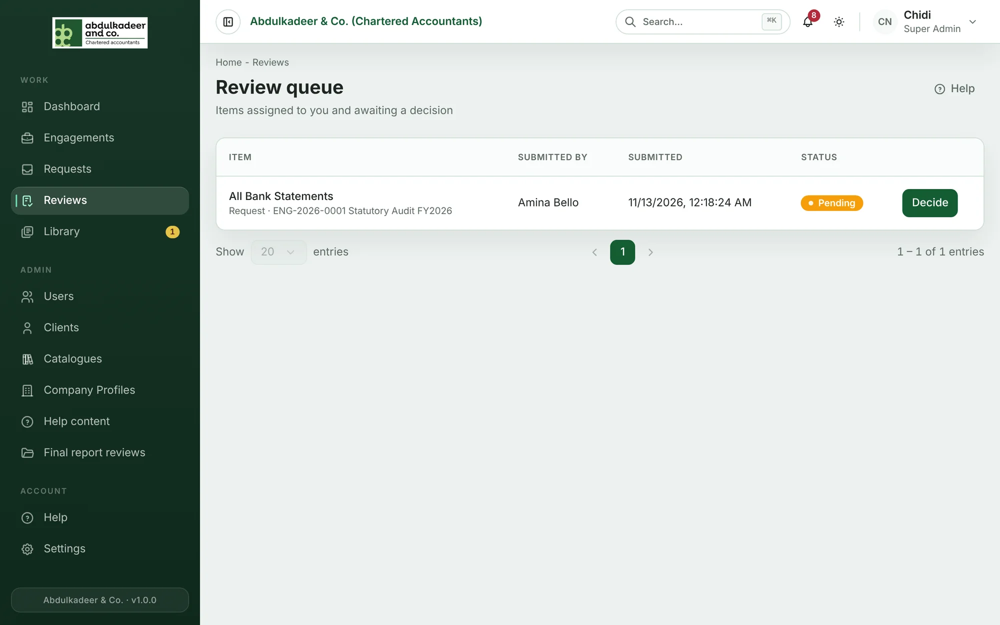
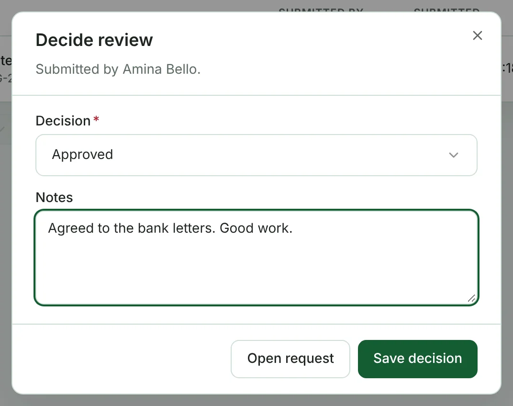

Internal review is a check by a senior before work is treated as done. It's separate from accepting the client's files.

## Submitting a request for review (staff)

1. Open the request. When the work is ready, the overview shows **Ready for internal review?** with **Submit for review**.
2. Choose the **Reviewer** from the engagement team and add **Notes** for them.
3. Click **Submit for review**.

The reviewer is notified (**Review requested**).

## Deciding a review (Super Admins)

Open **Reviews** in the menu. The **Review queue** lists what's waiting for you: the item, its engagement, who submitted it and when. Click the item's name to open it.

1. Click **Decide**.
2. Choose **Approved** or **Sent back**. Notes are required when you send work back.
3. Click **Save decision**.

The person who submitted it is notified of the outcome (**Review decided**).
