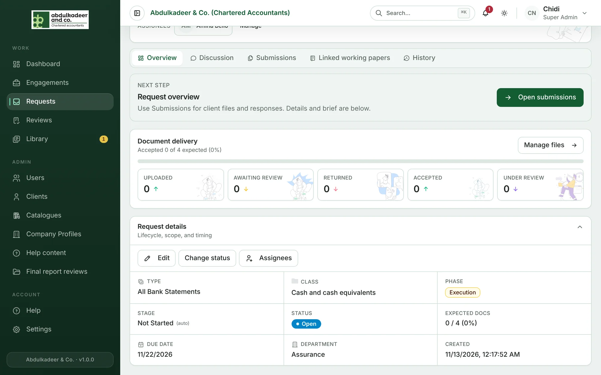
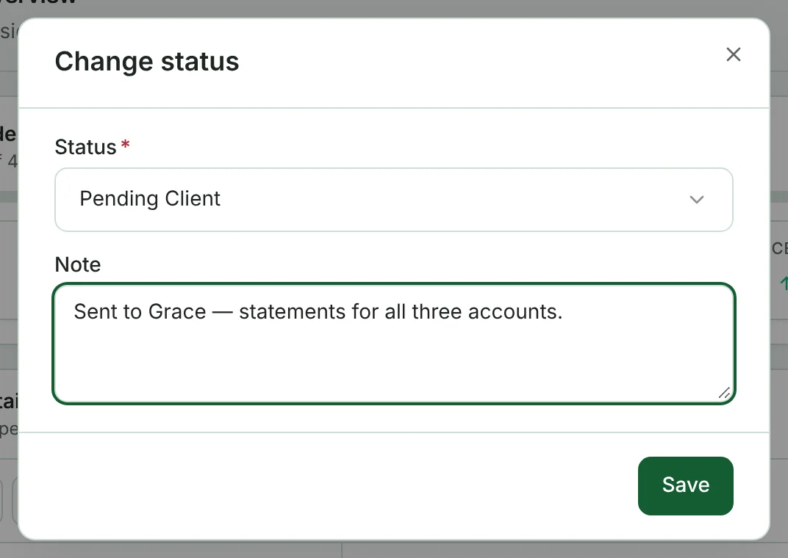
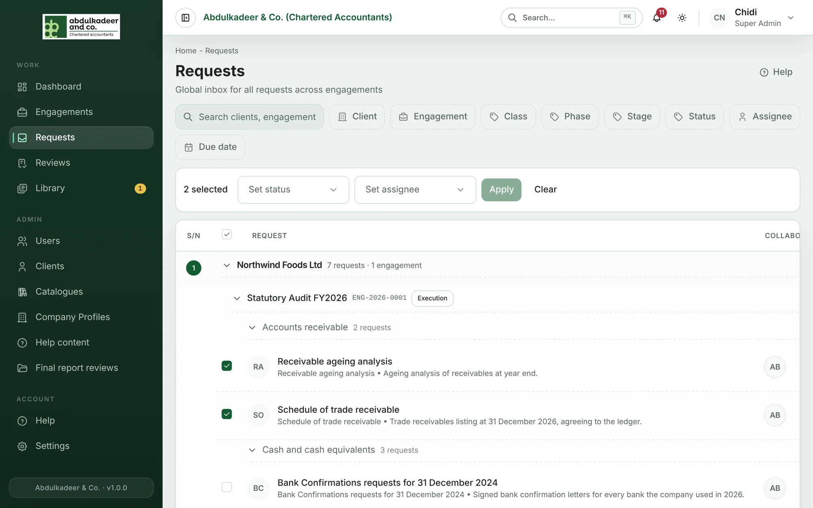

**Staff** and **Super Admins** can change a request's status, details and assignees. Staff can do this on the engagements they're on the team of; Super Admins on any engagement. Only Super Admins can delete a request.

## Request details

Open the request. At the bottom of the **Overview** tab, **Request details** (*Lifecycle, scope, and timing*) shows the type, class, phase, stage, status, expected documents, due date, department and when it was created. Above them are the actions:

### Change status

1. Click **Change status**.
2. Choose the new status and add a note if it helps.
3. Click **Save**.

Set **Pending Client** when you send a request to the client, and **Accepted** or **Closed** when it's done. The assignees and the team are notified, and the change is kept in the request's **History**.

### Edit

**Edit** changes the **Description**, **Expected documents** and **Due date**.

### Assignees

**Assignees** opens **Manage assignees**. Only people on the engagement team can be assigned — add someone to the team first (see [Team and client contacts](help:engagement-team-and-contacts)). Each new assignee gets a notification.

### Delete (Super Admins)

**Delete** is at the top right of the request page, next to **Engagement**. A request can be deleted only if the client hasn't sent anything and no documents are linked to it. Deleting is permanent.

## Changing many requests at once

On the [Requests page](help:the-requests-page), tick the requests you want, then use **Set status** and/or **Set assignee** in the bar that appears and click **Apply**. **Clear** unticks everything.

**Set assignee** lists the people on the teams of the engagements you can see. The person you choose must be on the team of every selected request's engagement — if they aren't, nothing is changed and the message names the person to add.

