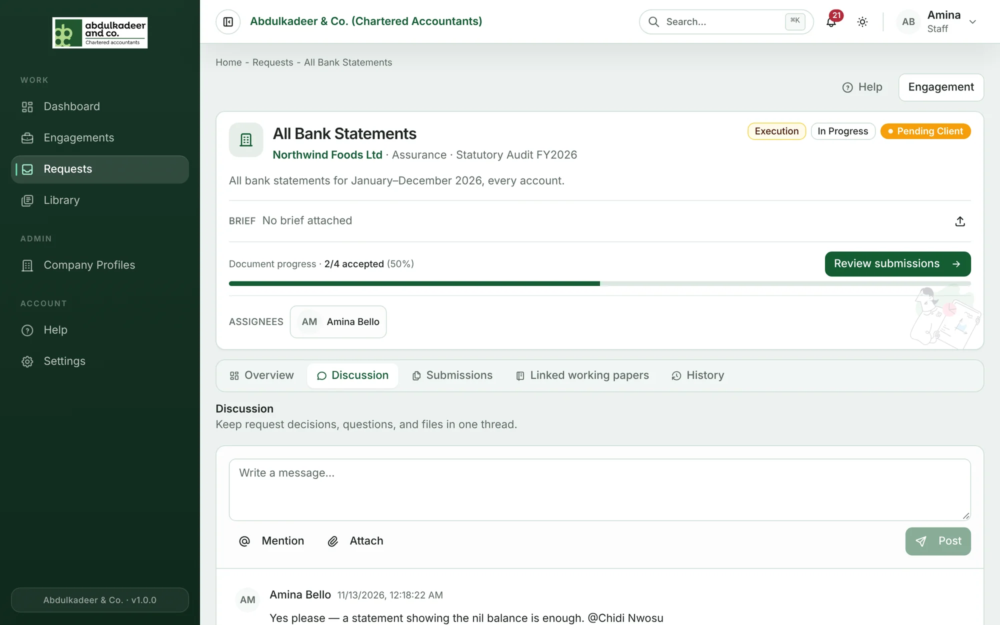
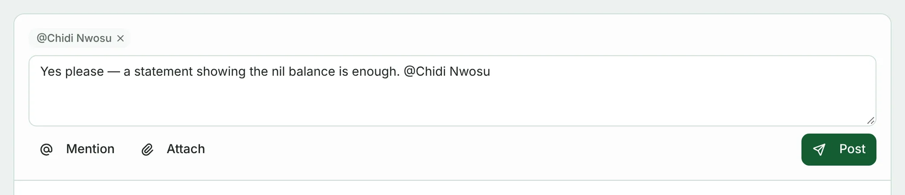

Every request has a **Discussion** tab: one thread shared by the engagement team and the client's contacts. Use it instead of email so the conversation stays with the request.

## Posting a message

1. Open the request and go to **Discussion**.
2. Type in **Write a message…**.
3. Optionally:
   - **Mention** — pick someone; they get a notification.
   - **Attach** — add files to the message.
   - Tag a file the client sent by using **Discuss this file** on the Submissions tab.
4. Click **Post** (or press **Ctrl + Enter**).

To reply to a specific message, use its reply button; **Cancel reply** goes back to a normal message. You can edit your own messages — edited ones are marked *(edited)*.

The engagement team, the request's assignees and the client's contacts on the engagement are notified of new messages (**Discussion message**) — in the app, and by email unless they've turned it off in **Settings → Notifications**.
