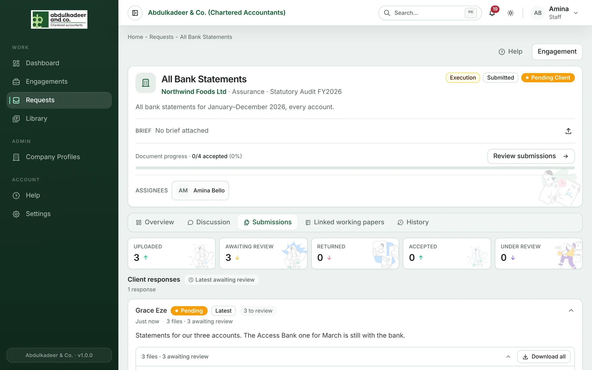
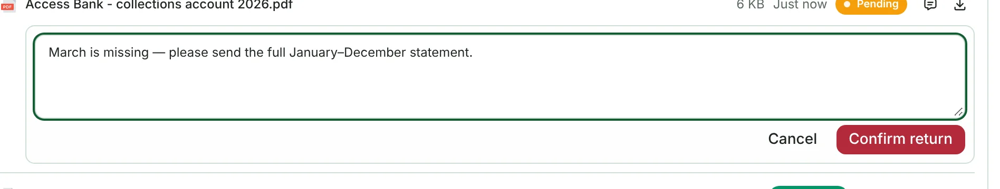
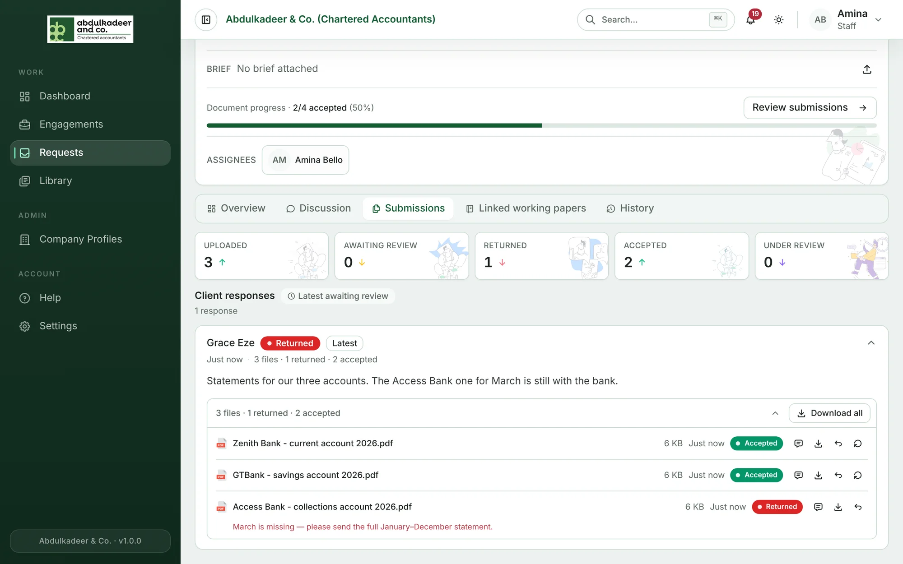

When a client sends files, the request's assignees (or the team) are notified (**Client submission**). Super Admins and staff on the engagement review them — file by file.

## Where to review

Open the request and go to the **Submissions** tab (or click **Review submissions** on the overview). At the top, the counts show what's **Uploaded**, **Awaiting review**, **Returned**, **Accepted** and **Under review**.

Each client response shows who sent it, when, their message, and its files.

Click a file's name to preview it in the browser — opening a pending file marks it **Under review** so the client can see you're on it. The download button saves a copy, and **Download all** gets every file in the response as a ZIP (you're notified when it's ready).

## Accept or return each file

- **Accept** — the file is what you needed. It counts towards the request's progress.
- **Return** — something's wrong. Write what to revise (for example *March is missing — please send the full January–December statement*) and click **Confirm return**. The client is notified and sees your reason next to the file.

When the client uploads a replacement for a returned file, it appears as a new pending file and the old one is marked **Replaced** (see **Show previous versions**).

## Changing your mind

On an accepted file:

- **Undo accept** — puts it back under review.
- **Reopen for review** — sends it back for another look, with a note explaining why.

On a returned file:

- **Undo return** — puts it back under review, with a note explaining why.

## Talking about a specific file

**Discuss this file** (the speech-bubble button) opens the request's discussion with that file tagged, so everyone knows which one you mean. See [Discussions](help:request-discussions).
