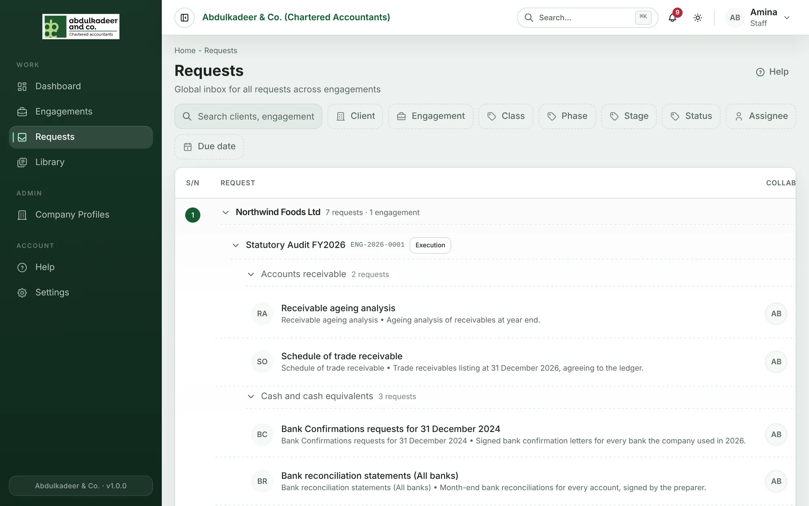

**Requests** in the menu is your inbox for requests across every engagement you can see. Requests are grouped by client, then engagement, then request class.

## Finding requests

- **Search** by client, engagement or request.
- Filter by **Client**, **Engagement**, **Class**, **Phase**, **Stage**, **Status**, **Assignee** and **Due date** (overdue, due today, next 7 days, no due date).
- Click a request to open it.

Clients see only their own organisation's requests; staff see requests on the engagements they're on.

## Bulk changes (Super Admins)

Tick requests to select them, then choose **Set status** and/or **Set assignee** and click **Apply**. See [Managing requests](help:managing-requests).
